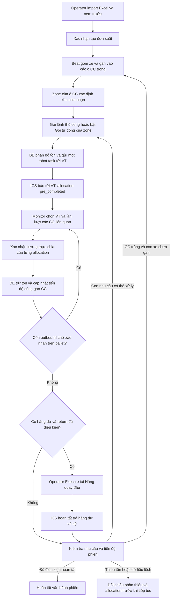
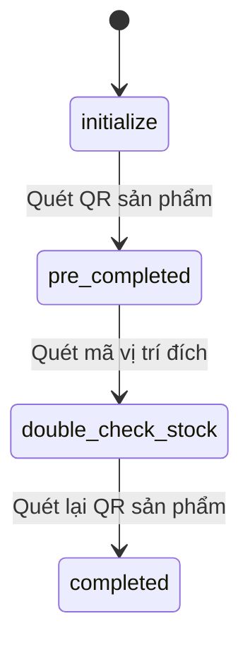

# Luồng hoạt động outbound — xuất kho (BE và FE)

Ngày đối chiếu mã nguồn: **28/10/2026**. Gọi tự động theo zone sử dụng dịch vụ cấp/Execute return của luồng thủ công: **import Excel → chia zone → cấp ra VT và tạo sẵn return → xác nhận CC → Execute return → lặp**. Tài liệu mô tả workspace, gồm chỉnh sửa chưa commit. Phần **tiếp quản return thủ công có sẵn** đã triển khai theo yêu cầu tiếp theo: migration `a82801vt0003`, image mới cho worker logic/callback và Beat, API Windows đã nạp lại. Giữ tự động tắt; không phát lệnh robot thử khi triển khai. Chi tiết và lỗi quãng đường còn tồn tại tại mục 9.7.

## 1. Phạm vi và các nhánh xử lý

**Luồng chính là operator Masan qua CC/VT**, có hai cách điều phối: gọi từng lệnh thủ công hoặc bật Gọi tự động của zone. Cả hai dùng calculate/execute, confirm và callback của nghiệp vụ thủ công; bộ điều phối bổ sung chọn SKU/VT, theo dõi lượt và bảo vệ gửi lệnh cho tự động. Lượt `native` cũ tiếp tục theo nhánh tương thích cho tới khi hoàn tất.

### 1.1. Đối chiếu quy trình thực tế với code

| Bước vận hành | FE hiện tại | BE hiện tại | Kết quả đối chiếu |
| --- | --- | --- | --- |
| 1. Import Excel | `SortingWaveOverviewPicker`: chọn file → xem trước → xác nhận tạo đơn | `parse-preview` → `create_outbound_order` | Có. Parse chỉ kiểm tra; sau xác nhận mới tạo đơn/dòng trong DB |
| 2. Hệ thống tự chia zone | Overview đọc gán CC cho từng khu | Beat `assign_cc_zone_task` → `assign_cc_zone` mỗi 5 giây | Có, theo cách gom xe và gán vào ô CC trống; zone lấy từ ô CC đó. Chưa cân bằng tải giữa zone |
| 3. Gọi robot tới VT | “Gọi lệnh” để chọn VT/SKU, hoặc “Gọi tự động” của zone | `sorting-dispatch` thủ công, hoặc bộ điều phối `masan_auto_service` | Có. Tự động chọn SKU có nhu cầu lớn nhất, kiểm tra cặp VT và phát lệnh theo lượt |
| 4. Xác nhận thực chia vào CC | Monitor: chọn VT → chọn CC đang có hàng từ VT đó → chọn lượng thực chia | `confirm-allocation` theo allocation ID → settle/trừ tồn → lưu liên hệ CC | Có với lượng xác nhận dương. Xác nhận ít hơn kế hoạch có điểm lệch cần lưu ý ở mục 9.4 |
| 5. Gọi return | Tự động khi zone bật; sau dừng dùng Execute trong Hàng quay đầu | Lượt mới tạo sẵn return khi cấp, confirm cập nhật dư, rồi xét đúng điều kiện `return-tasks` thủ công để gửi | Có dư, đủ điều kiện thủ công và đường đi cho phép mới gửi |
| 6. Tiếp tục đến hết phiên | Tự động lặp hoặc thao tác thủ công khi đã dừng | Điều phối BE và Beat 5 giây; callback/xác nhận đánh thức ngay | Nhận cả đơn mới. Hết nhu cầu thì chờ; chưa có API đóng phiên riêng |

Đường đọc cho luồng chính: **mục 2 → mục 4.3 → mục 9 → mục 7.2 → mục 14**. Các mục admin, QR và manual bên dưới là nhánh hỗ trợ đang tồn tại trong repo.

### 1.2. Các giao diện liên quan

| Nhánh | Màn hình / điểm vào | Cách xử lý |
| --- | --- | --- |
| Quản trị đơn xuất | `/export`, `/export/:orderId` | Tạo/import đơn → chọn dòng → phân bổ → thực thi → xác nhận xuất → trả dư |
| Operator chia chọn Masan — luồng chính | `/export` theo vai trò operator → `/export/zone/:zoneId`; xác nhận tại `/monitor/zone/:zoneId` | Import → tự gán CC/zone → gọi tới VT → xác nhận lượng vào CC → return → lặp |
| QR tablet | `/qrtablet/export`, `/qrtablet/export/:orderId` | Xem đơn, phân bổ, thực thi và xác nhận bằng QR; hỗ trợ các bước kiểm tra hàng thủ công |
| Kho thủ công / đơn “Lấy lẻ” | Dùng màn hình chi tiết đơn | Allocation không gắn robot; xác nhận trực tiếp hoặc quét QR theo từng bước |

Route FE được khai báo trong [routes/index.tsx](../frontend/src/routes/index.tsx). `/export` dùng `RoleGatePage` để chọn giao diện admin/operator. Các router BE trong tài liệu được đăng ký dưới tiền tố **`/api/v1`** tại [main.py](../backend/app/main.py).

Hai khái niệm khác nhau cần phân biệt:

- `outbound_type` / `detail_type`: chế độ vận hành `auto` hoặc `manual`.
- `order.details.type`: loại nghiệp vụ như `Tuyển chọn`, `Lấy lỗi`, `Lấy lẻ`; có thể thay đổi cách tính lượng cần xuất và chiến lược chọn tồn.

## 2. Sơ đồ phiên xuất đang sử dụng



Sơ đồ thể hiện vòng nghiệp vụ. Khi bật tự động, BE chọn VT/SKU và gửi return, operator vẫn xác nhận CC. Nhánh “hoàn tất vận hành phiên” là tiêu chí mục 9.6, chưa phải API đóng phiên; chế độ tự động vẫn bật và chờ nhu cầu mới cho tới khi người dùng dừng.

`calculate` bên trong dispatch tạo allocation và giữ lượng khả dụng, chưa trừ `ItemStock.quantity`. Callback robot tới VT chuyển allocation outbound sang `pre_completed`. Khi xác nhận lượng thực chia vào CC, BE mới trừ tồn. CC là đích chia chọn nghiệp vụ; stock pallet dư vẫn ở VT để trả về kệ, không được chuyển thành một stock mới tại CC trong nhánh xác nhận này.

## 3. Dữ liệu BE và quy tắc trạng thái

### 3.1. Các thực thể chính

| Thực thể | Vai trò / trường đáng chú ý |
| --- | --- |
| `OutboundOrder` | Header: `order_code`, `warehouse_id`, người tạo, ghi chú, metadata `details` |
| `OutboundOrderDetail` | Dòng yêu cầu: `item_id`, `quantity`, tên `unit`, `detail_type`, metadata xe/khách/chuyến/locator, `sorting_location_id` |
| `OutboundOrderAllocation` | Phân bổ một phần yêu cầu vào `item_stock_id`; có `quantity`, `status`, vị trí đầu/cuối, `allocation_type`, `robot_task_id` |
| `ItemStock` | Tồn thực tế, vị trí hiện tại, LOT, trạng thái và `available_quantity` tính toán |
| `RobotTask` | Lệnh vận chuyển: `order_id` dạng chuỗi, `quantity` của pallet, process code, `taskPath` |
| `TaskStatus` | Các callback ICS; trạng thái robot lấy từ bản ghi mới nhất |
| `History`, `Transaction` | Lịch sử nghiệp vụ đơn và giao dịch xuất/trả |

Quan hệ chính: `Order → nhiều Detail → nhiều Allocation → ItemStock`; allocation tự động còn liên kết `RobotTask`. Một task có thể gom allocation từ nhiều dòng, kể cả nhiều đơn. `RobotTask.order_id` như `TDS_Outbound_...` là mã lệnh robot, khác `OutboundOrder.id` dạng số và `order_code` của đơn.

Nguồn: [outbound_order_model.py](../backend/app/modules/warehouse/outbound_order/outbound_order_model.py), [item_stock_model.py](../backend/app/modules/warehouse/item_stock/item_stock_model.py), [robot_model.py](../backend/app/modules/robot/robot_model.py).

### 3.2. Tồn thực tế, tồn khả dụng và lượng còn thiếu

```text
ItemStock.available_quantity
  = ItemStock.quantity
    - tổng allocation outbound chưa completed / failed / cancelled

Detail.unallocated_quantity
  = Detail.quantity
    - tổng allocation outbound không failed / cancelled

lacked.quantity
  = phần yêu cầu chưa được phân bổ, chỉ trả các dòng có phần còn lại > 0
```

Allocation `return` không làm tăng lượng đã phân bổ xuất, cũng không giữ thêm tồn theo công thức trên. Allocation outbound đã `completed` vẫn được tính là đã đáp ứng yêu cầu dòng, nhưng không tiếp tục giữ tồn khả dụng vì tồn thực đã được trừ.

Ví dụ: tồn pallet 100, đơn cần 60. Sau calculate: tồn thực 100, khả dụng 40. Sau xác nhận đủ 60: tồn thực 40, allocation outbound completed; 40 còn lại là hàng dư cần xử lý trả nếu đã tạo allocation return.

### 3.3. Trạng thái allocation và robot

| Trạng thái allocation | Ý nghĩa trong luồng |
| --- | --- |
| `initialize` | Đã phân bổ, chưa thực thi |
| `issued` | Đã chuẩn bị/gửi lệnh vận chuyển |
| `in_progress` | ICS báo đang thực hiện |
| `pre_completed` | Pallet đã tới đích hoặc đã qua bước QR đầu; chờ xác nhận tiếp |
| `double_check_stock` | Đã quét vị trí đích trong luồng QR thủ công; chờ quét lại sản phẩm |
| `confirmed` | Trạng thái trung gian khi xác nhận số lượng Masan, trước khi settle |
| `completed` | Đã hoàn tất allocation xuất/trả |
| `failed`, `cancelled` | Robot lỗi/hủy; allocation outbound không còn giữ lượng khả dụng |

Luồng tự động thông thường:

```text
outbound: initialize → issued → in_progress → pre_completed → completed
return:   initialize → issued → in_progress → completed
```

ICS ánh xạ `6 → in_progress`, `7 → failed`, `3 → cancelled`, `8 → completed`. Với allocation **outbound**, callback `8` được xử lý thành **`pre_completed`**. Với allocation **return**, callback `8` hoàn tất allocation trả.

FE dùng [outboundRobotTaskDisplay.ts](../frontend/src/utils/outboundRobotTaskDisplay.ts) để kết hợp trạng thái task với allocation. Vì thế task robot có thể `completed` trong khi UI vẫn hiện chờ xác nhận xuất.

### 3.4. Trạng thái dòng và đơn là giá trị tính toán

`OutboundOrder.status` và `OutboundOrderDetail.status` là SQLAlchemy `column_property`, không phải cột trạng thái được gán tuần tự trong service.

Thứ tự xét trạng thái dòng:

1. `in_progress` nếu đã có allocation hợp lệ nhưng tổng lượng phân bổ xuất khác lượng yêu cầu; hoặc đã có allocation rời `initialize` trong khi vẫn còn allocation chưa `completed`.
2. `completed` nếu có allocation và tất cả allocation được xét đều completed.
3. `reserved` nếu còn allocation initialize và không rơi vào các điều kiện trước.
4. `initialize` nếu chưa có allocation được xét.

Đơn là `completed` khi mọi dòng completed; `reserved` khi mọi dòng reserved; `initialize` khi mọi dòng initialize hoặc đơn chưa có dòng. Các tổ hợp trạng thái khác, hoặc có dòng in_progress, làm đơn `in_progress`.

Khi xét sự tồn tại/trạng thái allocation, code bỏ qua `failed` và `cancelled`, **riêng return failed vẫn được xét** để phản ánh việc trả chưa xong. Return initialize cũng có thể giữ dòng/đơn ở in_progress dù phần xuất đã hoàn tất. Chuỗi `status: completed` trong response xác nhận hoặc một bản ghi History không thay thế việc đọc lại trạng thái tổng hợp của đơn.

## 4. Import Excel và các cách tạo/xem đơn

### 4.1. Danh sách và mở chi tiết

Đây là nhánh quản trị hỗ trợ. Luồng operator chính import ngay ở overview như mục 4.3 và tiếp tục qua màn hình CC/VT.

1. `OutboundPage` lấy `selectedWarehouseId` từ app store, gọi `useGetOutboundOrders`.
2. FE gửi kho, trang, từ khóa, trạng thái và khoảng ngày tới `GET /outbound-orders`.
3. BE lọc dữ liệu, trả `items`, `total`, `page`, `page_size`, `summary`.
4. Người dùng mở đơn tại `/export/:orderId`.
5. `OutboundDetailPage` đọc header, details, lacked và danh sách task. Nhánh auto đọc robot task; nhánh manual/Lấy lẻ đọc task tổng hợp từ allocation không có robot.

### 4.2. Tạo bằng form

`CreateOutboundModal` cho nhập mã đơn, ghi chú, metadata và các dòng SKU/số lượng/đơn vị. Mã mặc định có dạng `OUT-YYYYMMDD-HHmmss`.

FE tải đơn vị của sản phẩm và quy đổi số lượng qua API đơn vị trước khi gửi `quantity` theo đơn vị cơ sở cùng `unit_id` cơ sở. Payload tạo đơn:

```json
{
  "order_code": "OUT-20261027-090000",
  "warehouse_id": 1,
  "note": "Xuất giao hàng",
  "details": {},
  "line_items": [
    {
      "item_id": 101,
      "quantity": 60,
      "unit_id": 1,
      "detail_type": "auto",
      "details": { "vehicle_no": "XE-01", "customer_name": "KH A" }
    }
  ]
}
```

FE gọi `POST /outbound-orders?outbound_type=auto`. Handler chuyển body và user ID vào task `outbound.create_order`; service tạo header, kiểm tra đơn vị, tạo dòng và History rồi commit. Tham số query `outbound_type` ở route tạo hiện không được truyền vào service; chế độ từng dòng lấy từ payload, có áp dụng quy tắc Lấy lẻ.

Quy tắc nghiệp vụ đặc biệt:

- `Tuyển chọn` / `Lấy lỗi`: yêu cầu LOT trên metadata đơn; BE tính lại lượng yêu cầu từ tổng tồn khả dụng phù hợp khoảng LOT.
- `Lấy lẻ`: BE tính lượng từ tồn `split`, ép detail thành `manual`, kể cả kho đang ở chế độ auto.
- Các đơn khác giữ lượng yêu cầu từ payload.

### 4.3. Import Excel Masan

Điểm vào chính: `/export` theo vai trò operator → `OperatorOutboundPage` → `SortingWaveOverviewPicker`.

```text
Chọn file Excel
  → POST /masan/outbound-orders/parse-preview
  → kiểm tra preview_rows / can_import / import_errors
  → operator xem trước và bấm “Tạo đơn xuất”
  → buildMasanOutboundCreateRequest
  → POST /outbound-orders
  → đóng preview, giữ màn hình overview
  → Beat tự gán xe vào CC/zone ở các lượt chạy tiếp theo
```

`parse-preview` nhận multipart `file`, `warehouse_id`, `outbound_type`. BE đọc workbook, xử lý ô merge, tìm SKU trong kho, kiểm tra số lượng, LOT và locator, rồi trả các dòng hợp lệ cùng lỗi/cảnh báo. Endpoint này chỉ chuẩn bị dữ liệu, chưa tạo đơn.

FE chặn import nếu có lỗi LOT được thu thập hoặc blocker; trường hợp lỗi dòng khác còn dữ liệu hợp lệ có thể cảnh báo bỏ qua dòng lỗi. `handleConfirmImport` tạo một đơn từ các dòng hợp lệ, mã `OUT-YYYYMMDD-HHmmss`, ghi chú mặc định `Import BM.04`. Metadata dòng giữ xe, khách hàng, chuyến, SKU, LOT và locator phục vụ các bước sau.

Import không trực tiếp gán zone và không gọi robot. Việc gán CC chạy ở task định kỳ riêng sau khi đơn được lưu. Nếu không còn CC trống thì xe chưa được gán phải đợi ô trống; không có cam kết mọi dòng của file đều được đưa vào các khu ngay trong request import.

Nhánh admin `OutboundPage` cũng import qua hai API trên, nhưng không có cùng bước preview xác nhận của operator và sẽ điều hướng tới chi tiết đơn sau khi tạo. Không dùng hành vi điều hướng của admin để mô tả màn hình operator.

Nguồn FE chính: `handleImportFileChange`, `handleConfirmImport` trong [SortingWaveOverviewPicker.tsx](../frontend/src/components/outbound/SortingWaveOverviewPicker.tsx), [masanOutboundImport.ts](../frontend/src/utils/masanOutboundImport.ts). Nhánh khác: [OutboundPage.tsx](../frontend/src/pages/OutboundPage.tsx), [CreateOutboundModal.tsx](../frontend/src/pages/components/CreateOutboundModal.tsx). Nguồn BE: `parse_masan_outbound_preview` trong [masan_outbound_service.py](../backend/app/modules/masan/masan_outbound_service.py).

## 5. Phân bổ hàng — calculate

Trong luồng operator, `sending_masan_outbound_task` gọi calculate bên trong sorting-dispatch cho các dòng chưa phân bổ không chỉ định locator. Operator không cần gọi API calculate riêng. Phần dưới giải thích cơ chế dùng chung; trên chi tiết đơn admin có thêm thao tác **“Xác nhận xuất” ở bước chọn dòng** để gọi calculate trực tiếp.

1. FE lấy các dòng đã chọn, gửi `warehouse_id`, `outbound_order_id`, `line_items` đến `POST /outbound-orders/calculate?strategy=fefo`.
2. BE kiểm tra danh sách không rỗng/không trùng ID, đơn thuộc kho, dòng thuộc đơn, SKU đúng và lượng xin phân bổ không vượt phần còn lại.
3. BE gom dòng theo `item_id`, nạp tồn có `available_quantity > 0`, active và thuộc zone lưu trữ trong `settings.zone_storage`.
4. Chiến lược mặc định `fefo` ưu tiên stock `available` trước `split`, rồi LOT từ/đến, thời điểm tạo và ID. Code hiện sắp theo LOT; không dùng `expiry_date` làm khóa sắp xếp chính.
5. `Tuyển chọn`/`Lấy lỗi` đổi sang `re_qc`, chọn khoảng LOT giao nhau. `Lấy lẻ` đổi sang `pick_split`, chỉ lấy tồn split.
6. `greedy_allocate_stocks_to_lines` lần lượt phân lượng tồn vào yêu cầu, tạo allocation outbound initialize.
7. Auto tạo hoặc dùng lại robot task initialize cùng vị trí nguồn; lượng robot task phản ánh toàn lượng hàng ở vị trí được lấy. Manual/Lấy lẻ không tạo robot task.
8. BE commit, tính lại lacked cho toàn đơn, trả `is_fully_allocated` và danh sách thiếu.
9. FE tải lại header/details/lacked/tasks và chuyển sang tab phân bổ.

Nếu không có tồn phù hợp cho một SKU, service báo lỗi và rollback phần calculate trong transaction đó. Nếu có tồn nhưng chưa đủ, phần có thể phân bổ vẫn được lưu và response nêu phần thiếu. `is_fully_allocated` dựa trên lacked **toàn đơn**, không chỉ các dòng vừa chọn.

Khi phân bổ lại phần thiếu, FE gửi `lacked.quantity`, không gửi lại toàn bộ lượng yêu cầu ban đầu. BE cũng kiểm tra phần còn lại để tránh phân bổ vượt yêu cầu.

Nguồn: `calculate_outbound_order`, `_validate_calculate_outbound_lines`, `_strategy_loading_stocks`, `greedy_allocate_stocks_to_lines`, `lacked_details` trong [outbound_order_service.py](../backend/app/modules/warehouse/outbound_order/outbound_order_service.py).

## 6. Thực thi tự động và callback robot

### 6.1. Execute

Trong luồng operator, `_pack_and_execute_robot_task` chuẩn bị allocation và gọi `execute_outbound_task` trong BE sau khi người dùng chọn VT/SKU. Nhánh admin/manual có thể chọn vị trí và gọi trực tiếp API sau:

```http
POST /api/v1/outbound-orders/execute?detail_type=auto
```

```json
{
  "order_id": "TDS_Outbound_example",
  "from_location_id": 1001,
  "to_location_id": 2001,
  "allocations": [{ "allocation_id": 501 }]
}
```

BE kiểm tra vị trí nguồn tồn tại, không empty/in_transit, robot task initialize, allocation thuộc đúng task và còn initialize. Với allocation outbound, nguồn phải khớp vị trí thực của stock.

Sau đó BE:

1. Gán vị trí và chuyển allocation sang issued.
2. Ghi `taskPath = mã_vị_trí_đầu,mã_vị_trí_đích`.
3. Nếu lượng pallet lớn hơn tổng lượng lấy, tạo `TDS_Return_...` và allocation return initialize theo chiều ngược lại, dùng inbound process code. Đây là tạo lệnh chờ, chưa gửi robot đi trả ngay.
4. Ghi History, gọi ICS qua `TaskStatusService.create_robot_task`, rồi commit. API thành công trả HTTP 204.

Task execute qua Celery có retry lỗi ICS được đánh dấu retryable, tối đa 3 lần với khoảng chờ 10/20/40 giây. API ánh xạ `ValueError → 400`; `IcsError → 503` khi không kết nối được, hoặc `502` cho lỗi ICS khác.

### 6.2. Callback

ICS gọi `POST /api/v1/receive-status` → task `persist_task_status` → `TaskStatusService.receive_task_status`.

- BE tìm task theo `orderId`, cập nhật allocation theo mã trạng thái và ghi `TaskStatus`.
- Thu thập thiết bị, thời điểm, pin và khoảng cách khi có dữ liệu phù hợp.
- Khi lượt outbound hoàn thành: allocation thành pre_completed; stock active ở nguồn được chuyển tới vị trí đích. Chưa trừ lượng đã xuất.
- `_send_taking_stock` tạo dữ liệu chờ chia chọn, lưu Redis và phát `masan.sorting.stock_ready` khi dòng có thông tin gán CC.
- Khi lượt return hoàn thành: settle allocation trả và chuyển stock về vị trí đích; không trừ lượng xuất thêm lần nữa.
- Sau hoàn thành, phát sự kiện robot task completed cho FE.

Nguồn: [robot_api.py](../backend/app/modules/robot/robot_api.py), [robot_service.py](../backend/app/modules/robot/robot_service.py), [outbound_celery_task.py](../backend/app/modules/warehouse/outbound_order/outbound_celery_task.py).

## 7. Xác nhận xuất, trừ tồn và trả dư

### 7.1. Xác nhận bằng QR hoặc không QR

Đây là các nhánh xác nhận bổ sung. Quy trình thực chia vào CC đang dùng gọi **Masan `confirm-allocation` ở mục 9.4**, không cần đi qua confirm-qr hoặc confirm-no-qr.

Hai API xác nhận thông thường chỉ lấy allocation outbound đang pre_completed:

- `POST /outbound-orders/id/{id}/confirm-qr`, body `{ "qr_code": "..." }`: tìm stock qua QR và xác nhận allocation của stock đó trong đơn.
- `POST /outbound-orders/confirm-no-qr`, body `{ "order_id": "TDS_Outbound_..." }`: xác nhận allocation theo task robot. FE admin có thao tác này trên dòng task chờ xác nhận.

`_settle_outbound_stock` chuyển allocation completed, kiểm tra đủ tồn, trừ `stock.quantity` đối với outbound, ghi Transaction/History và kiểm tra thông báo tồn. Allocation return chỉ được hoàn tất và ghi giao dịch trả, không trừ tồn xuất.

Response có `overall` và `return_quantity`. FE hiển thị lượng đã xuất, đồng thời nhắc thực hiện lệnh TRẢ nếu còn hàng dư. Sau đó phải đọc lại trạng thái dòng/đơn vì có thể vẫn còn allocation khác hoặc return chưa hoàn tất.

### 7.2. Điều kiện hiển thị lệnh trả tại khu VT

Phần này mô tả điều kiện trả thủ công, cũng được lượt `manual_services` mới sử dụng nguyên vẹn. Điều kiện chờ toàn detail được giữ lại theo quyết định vận hành. Lượt `native` cũ dùng điều kiện theo pallet của nhánh tương thích.

`GET /masan/outbound-orders/sorting-zone/return-tasks` đọc trực tiếp task/allocation trong DB, không phụ thuộc việc cache gán CC đã bị dọn.

Service `list_sorting_zone_return_tasks` chỉ trả các lệnh sẵn sàng: task và allocation return initialize, nguồn thuộc đúng kho/zone VT, stock active còn hàng và đang ở nguồn, lượng trả hợp lệ, có outbound completed tương ứng, không còn outbound chờ xử lý trên dòng hoặc cùng pallet tại VT.

Để gọi trả trong quy trình hiện tại: mở **Gọi lệnh → chọn VT → bảng “Hàng quay đầu”** bên trong `SortingItemsNeededModal`. `MasanSortingReturnTasksSection` lọc theo VT đã chọn và tải lại danh sách mỗi 5 giây khi được bật. Có thể Execute lệnh trả tại đây mà không cần chọn SKU xuất mới.

Người dùng Execute → gọi lại `/outbound-orders/execute?detail_type=auto` với chiều VT về kệ → chờ callback hoàn thành. Việc tạo return và việc thực thi return là hai bước riêng. Nếu xuất hết pallet và stock bằng 0, nhánh này không có lệnh trả hàng dư; chưa thấy nhánh riêng tạo return pallet rỗng trong các hàm xử lý này.

Nguồn: [masan_sorting_return_service.py](../backend/app/modules/masan/masan_sorting_return_service.py), [MasanSortingReturnTasksSection.tsx](../frontend/src/components/outbound/MasanSortingReturnTasksSection.tsx).

## 8. Nhánh thủ công và QR tablet

[outboundFlow.ts](../frontend/src/utils/outboundFlow.ts) xác định nhánh manual khi kho `manual` hoặc `order.details.type` là Lấy lẻ. BE cũng ép Lấy lẻ thành manual khi tạo/sửa/thực thi.

`GET /manual-allocation-tasks/{order_id}` gom allocation không có robot theo `allocation_type:item_stock_id`, trả task hiển thị dạng `MANUAL_outbound_<stock_id>` hoặc `MANUAL_return_<stock_id>`. Đây là task tổng hợp để FE thao tác.

### 8.1. Xác nhận trực tiếp

FE gọi `/outbound-orders/execute?detail_type=manual`. `_execute_outbound_task_manual` yêu cầu vị trí đầu/cuối và allocation initialize, tạo allocation return nếu có dư, chuyển stock tới đích rồi gọi settle. Nhánh này không gọi ICS.

### 8.2. Xác nhận bằng QR nhiều bước

FE dùng `/outbound-orders/execute-qr-manual` với `allocation_ids`, `qr_code` và `to_location_id` nếu đã chọn:



- Bước 1: BE kiểm tra SKU, LOT và đủ lượng. Nếu QR là stock khác cùng SKU/LOT, code có thể đổi `item_stock_id` sang stock được quét; allocation chuyển pre_completed.
- Bước 2: mã vị trí được tìm theo `location_code`, `bin_code` hoặc `location_name`; kiểm tra đích phù hợp, chuyển double_check_stock. Chưa trừ tồn.
- Bước 3: QR phải trỏ đúng stock đã gắn với allocation; BE cập nhật vị trí stock, trừ lượng, chuyển completed và ghi Transaction.

Nhánh QR nhiều bước cập nhật trực tiếp trong `execute_qr_manual`, không gọi `_settle_outbound_stock` ở bước cuối. Không nên mặc định nó ghi đầy đủ cùng History/thông báo hoặc tạo return giống nhánh execute trực tiếp.

FE chọn allocation ở bước đang hoạt động, ưu tiên pre_completed → double_check_stock → initialize, và đổi hướng dẫn quét theo trạng thái. QR tablet còn có luồng xác nhận outbound đã tới trạm bằng API confirm-qr thông thường.

Nguồn: [QrTabletOutboundDetailPage.tsx](../frontend/src/pages/qrtablet/QrTabletOutboundDetailPage.tsx), [outboundManualQrScan.ts](../frontend/src/utils/outboundManualQrScan.ts), `execute_qr_manual` trong service outbound.

## 9. Chi tiết luồng chính: chia zone → VT → CC → return → lặp phiên

### 9.1. Chọn khu và duyệt nhu cầu

`OperatorOutboundPage` hiển thị overview qua `SortingWaveOverviewPicker`, có import và “Gọi lệnh” cho từng khu. Từ overview có thể gọi lệnh ngay; sau dispatch thành công, FE mở khu tương ứng. Màn hình chi tiết `OperatorOutboundDetailPage` cũng có nút “Gọi lệnh”, bản đồ CC/VT, danh sách đơn, phần thiếu và theo dõi robot. Từ đây có thể chuyển sang `/monitor/zone/:zoneId` để xác nhận chia theo từng ô CC.

`OperatorOutboundOrderBrowser` duyệt theo **Đơn → Xe → Khách hàng → Chuyến → Dòng hàng**, qua các API operator-board. Backend tính `done_coverage` none/partial/full; chỉ detail completed được xem là xong. Chuyến rỗng được mã hóa trên URL bằng `_empty`.

Mapping hiện tại trong [outboundMapZones.ts](../frontend/src/constants/outboundMapZones.ts):

| Display zone trên URL | Khu hiển thị | Zone VT | Zone CC | Mã CC gửi cho nhu cầu/dispatch | Mã VT gửi cho robot/return |
| --- | --- | --- | --- | --- | --- |
| 8 | Khu vực chia chọn 2 | 8 | 11 | `Zone_CC_02` | `Zone_sorting_1` |
| 9 | Khu vực chia chọn 1 | 9 | 10 | `Zone_CC_01` | `Zone_sorting_2` |

`warehouse_id` là ID kho, `zoneId` trên URL là khu hiển thị, còn query/body `zone` của API Masan là **Zone.code**. Nhu cầu và dispatch dùng mã zone CC; truy vấn task robot/return dùng mã zone VT.

### 9.2. Tự động gán xe vào CC

Đây là phần người vận hành gọi là **“hệ thống tự chia sang các zone”**. Celery Beat khai báo `outbound.assign_cc_zone` mỗi **5 giây**. Task duyệt các kho và gọi `assign_cc_zone`:

1. Tìm ô CC active thuộc `settings.zone_cc` chưa được gán trong cache; sắp tăng dần theo phần số trong `location_name`, rồi tên vị trí.
2. Lấy dòng initialize thuộc đơn chưa completed và chưa được gán CC.
3. Gom dòng theo `details.vehicle_no` (thiếu xe dùng `no_vehicle`).
4. Lần lượt gán mỗi nhóm xe vào một ô trống và lưu cache hai chiều. Zone của nhóm được lấy từ `available_location.zone.code`.

Code đang chạy không tách file Excel thành các đơn theo zone, không ghi zone lên header đơn và không tối ưu cân bằng số lượng/SKU giữa hai zone. Nhóm được gom theo xe trên các đơn chưa hoàn tất của kho; cùng biển số trong nhiều đơn có thể được gom chung. Khi một lượt gán có ít ô trống hơn số nhóm xe, phần còn lại đợi những lượt Beat sau. Thứ tự lấy dòng/nhóm xe chưa có `order_by` rõ ràng nên không nên coi là cam kết FIFO theo file import.

Trong file có phác thảo `_assigning_algorithm` nhưng đang comment; tài liệu chỉ tính `assign_cc_zone` đang thực thi. Các ô CC của hai zone được xét chung theo thứ tự vị trí, nên “tự chia zone” hiện là kết quả gán CC, không phải chia đều tải giữa zone.

Các key chính:

```text
outbound:assigned_cc_location:{warehouse_id}:{cc_location_id}
outbound:assigned_cc_details:{warehouse_id}:{detail_id}
outbound:masan:stock_ready:{warehouse_id}:{cc_zone}:{allocation_id}:{cc_location_id}
```

Các cache trên được ghi với TTL `-1` theo cách gọi hiện tại. Chức năng gán tự động phụ thuộc tiến trình Beat/worker đang chạy. FE overview và màn hình khu đọc lại gán CC theo chu kỳ 5 giây; request import không đợi hoàn tất gán CC.

### 9.3. Chọn VT/SKU và dispatch

Đây là nhánh gọi từng lệnh thủ công. Khi zone đang bật tự động, FE khóa thao tác này và BE từ chối request thủ công; chuyển sang bộ điều phối ở mục 9.7.

1. Người dùng đã chọn người xuất cho khu bấm **Gọi lệnh**, chọn vị trí VT trong `MasanVtLocationPickerModal`, rồi chọn một SKU trong `SortingItemsNeededModal`. Danh sách SKU đến từ `/masan/outbound-orders/sorting-items-needed` theo warehouse và zone CC, được tải lại mỗi 5 giây khi modal mở.
2. `useMasanVtSortingDispatch` lấy SKU được chọn và gửi `/masan/outbound-orders/sorting-dispatch` với `warehouse_id`, `zone`, `item_id`, `to_location_id`.
3. BE chặn khi đích đang có allocation robot issued/in_progress đi tới.
4. BE đọc các dòng đã gán CC theo SKU. Dòng có locator được xử lý theo vị trí chỉ định; dòng không locator được gom theo đơn để calculate FEFO.
5. BE chọn allocation outbound initialize đầu tiên, gom các allocation cùng robot task và gọi execute tự động tới VT. Task có thể phục vụ nhiều dòng/CC; cần đối chiếu toàn bộ allocation của task khi xác nhận.
6. FE cập nhật truy vấn nhu cầu, CC, bản đồ, task, danh sách đơn và phần thiếu; cảnh báo nếu response còn lacked.

Một lần dispatch hiện chọn **một robot task** để thực thi; operator gọi tiếp khi cần pallet tiếp theo. FE thực tế chỉ cho chọn một SKU, phù hợp việc hook xử lý `picked[0]`. Sau khi gửi, `_apply_clear_outbound_masan_details` giảm lượng kế hoạch trong cache CC theo lượng đã dispatch; phần này chưa phải lượng thực chia đã được xác nhận.

Nhu cầu SKU hiện được tổng hợp từ `detail.quantity` của các dòng chưa completed trong cache gán CC, không phải phép tính trực tiếp “lượng ban đầu trừ tổng thực chia”. Vì vậy số trên danh sách SKU và danh sách lacked không thay thế nhau.

Nút **Gọi lệnh → VT/SKU** là nhánh có gửi API thật. Trong `OperatorOutboundDetailPage` còn hàm `handleCallRobot` dùng danh sách task demo và chỉ log console; không dùng hàm đó để giải thích việc gửi robot của quy trình hiện tại.

### 9.4. Pallet tới VT và xác nhận số lượng thực chia vào CC

Sau callback completed, allocation outbound thành pre_completed. BE lưu stock-ready, phát WebSocket; FE tô trạng thái lên bản đồ và tải lại hàng chờ.

Thao tác chính tại **Monitor**:

Trên `/monitor` và `/monitor/zone/:zoneId`, ô VT hiển thị **mã hàng | tồn tại VT (-tổng lượng còn cần chia CC) | lot**, ví dụ `02xx132 | 98 (-12) | 141026`. Số trong ngoặc là tổng quantity của các allocation outbound `pre_completed` có đích là VT đó trên tất cả ô CC của zone; không tính allocation đã confirmed/completed. Số này giảm sau khi xác nhận chia CC và bằng `(-0)` khi không còn lượng chờ chia. Tồn tại VT vẫn lấy từ API map status.

1. Chọn người xuất cho khu trên thanh công cụ; FE cần có `sorting_persons` mới cho xác nhận.
2. Chọn VT đang có pallet. `MonitorZoneInteractiveMap` tải lại pending-stock và gọi `/masan/outbound-orders/start-sorting-time` cho các allocation chờ tại VT; mốc đã có không bị ghi đè.
3. FE làm nổi các CC có hàng chờ từ đúng VT đang chọn và vẫn đang gán xe. Chọn từng CC để mở modal “Xác nhận lấy hàng tại CC”.
4. Modal chỉ lấy allocation pre_completed của cặp **VT đã chọn + CC đang mở**. Điều chỉnh lượng thực đã chia bằng slider, mặc định bằng lượng kế hoạch. Lượng 0 bị bỏ khỏi request; FE chặn lượng lớn hơn kế hoạch.
5. FE gửi `/masan/outbound-orders/confirm-allocation`:

```json
{
  "warehouse_id": 1,
  "zone": "Zone_CC_01",
  "quantities": { "501": 60 },
  "sorting_persons": "operator1,operator2"
}
```

Request không truyền một `cc_location_id` mới: CC đã được xác định qua gán detail trong cache và việc FE lọc allocation theo CC. “Xác nhận vào CC” là xác nhận lượng của các allocation thuộc CC đã gán, không phải chọn lại đích chia tùy ý tại bước xác nhận.

BE gán confirmed, lưu người xuất và thời điểm kết thúc chia, cập nhật cache stock-ready, gọi settle để trừ tồn/chuyển completed. Khi dòng không còn allocation outbound đang chờ, `_clear_cache_details` lưu `detail.sorting_location_id` từ CC đã gán và dọn gán cache dòng/ô tương ứng. Stock pallet không được đổi vị trí sang CC ở bước này; lượng dư vẫn nằm tại VT.

`_delete_stock_ready_cache_for_allocation` hiện **cập nhật** bản ghi cache sang completed và lượng xác nhận, không xóa key dù tên hàm có chữ delete. FE ẩn completed/confirmed khỏi bản đồ và hàng chờ. Có thể xác nhận hết hàng chờ của một VT ngay trên màn hình xuất; cách đó gom theo VT, còn Monitor hỗ trợ lần lượt từng CC như quy trình đang dùng.

**Điểm lệch khi thực chia ít hơn kế hoạch trong nhánh thủ công cũ:** code đặt `allocation.quantity = lượng_xác_nhận` và giảm `detail.quantity` đi chính lượng xác nhận khi hai lượng khác nhau. Chưa có nhánh tạo dòng nhu cầu bổ sung tương ứng để chắc chắn xử lý tiếp cho đủ yêu cầu ban đầu. **Lượt tự động chưa hỗ trợ chia thiếu:** BE yêu cầu xác nhận đúng lượng allocation, không chạy nhánh sửa lượng này.

Ví dụ suy ra từ code, không phải kết quả chạy thực tế: dòng yêu cầu 60, allocation kế hoạch 60, thực chia 40 → allocation completed có lượng 40, nhưng `detail.quantity` thành 20; lượng chưa phân bổ tính bằng `20 - 40 = -20`. Dòng có thể vẫn in_progress dù không hiện trong lacked. Việc dọn CC chỉ kiểm tra còn outbound chờ hay không, chưa kiểm tra đủ nhu cầu ban đầu; do đó không thể cam kết cứ gọi tiếp là tự bù đủ 20 còn thiếu. Lượng 0 cũng không được dùng để đóng allocation vì FE bỏ qua và schema BE yêu cầu lượng dương.

Sau xác nhận, lệnh trả được phát hiện theo DB như mục 7.2, kể cả khi CC đã được giải phóng cache. Các allocation còn pre_completed trên cùng pallet phải được xử lý tiếp trước khi lệnh return được API coi là sẵn sàng.

### 9.5. Return và bắt đầu vòng tiếp theo

Các bước dưới đây áp dụng cho nghiệp vụ thủ công và lượt tự động mới dùng dịch vụ chung. Với lượt mới, bộ điều phối tự thực hiện Execute, bổ sung khóa theo cặp và đồng bộ lượng return trước gửi; xem mục 9.7. Nhánh `native` cũ vẫn tạo return muộn.

1. Nếu có dư theo kế hoạch, lệnh return đã được tạo chờ từ bước execute outbound. Khi xác nhận lượng khác kế hoạch, BE tìm return theo stock để cập nhật lượng bằng tồn còn lại hoặc tạo return nếu chưa có.
2. Operator mở Gọi lệnh, chọn VT và Execute trong **Hàng quay đầu**. Bảng chỉ hiện return đạt các điều kiện mục 7.2; không phụ thuộc CC còn gán hay đã giải phóng.
3. API execute gửi đường đi VT → vị trí nguồn ban đầu tới ICS. Callback completed chuyển stock active tại VT về đích, hoàn tất allocation return và tính lại trạng thái dòng/đơn.
4. Operator gọi VT/SKU tiếp theo. Các allocation outbound initialize đã tạo cho pallet kế tiếp có thể được dispatch tiếp. Xe chưa gán sẽ được Beat gán vào các CC đã trống.

Điều kiện ready còn xét **mọi outbound chưa xong của cùng detail**, kể cả allocation nằm trên pallet khác. Vì vậy đã xác nhận hết các CC của pallet đang ở VT vẫn chưa bảo đảm thấy return nếu cùng dòng yêu cầu còn allocation initialize/in_progress ở lượt khác. Đây là điểm cần đối chiếu khi vận hành theo vòng “một pallet → chia → trả → pallet tiếp”.

Nhánh thủ công cũ không tự gọi SKU kế tiếp sau callback. `_exist_robot_task` chỉ xét cùng đích; khi có lượt tự động, guard dùng chung bổ sung kiểm tra sở hữu VT, nguồn và đường đi. Bộ điều phối mới ở mục 9.7 tự tiếp tục khi zone đang bật.

Khi BE sửa lượng return allocation đã tồn tại, code chỉ gán `return_allocation.quantity = stock.quantity`, không đồng thời sửa `RobotTask.quantity`. Vì vậy lượng hiển thị cấp task có thể khác lượng allocation sau xác nhận lệch kế hoạch; cần đối chiếu khi xử lý hàng dư.

### 9.6. “Hết phiên” đang được hiểu thế nào trong code?

Import tạo `OutboundOrder` và các detail. Chưa có `session_id` gắn một file với một phiên đóng/mở riêng. Chế độ tự động có trạng thái điều khiển theo kho/zone và các lượt VT bền vững trong DB; không phải một phiên giới hạn vào đúng file vừa import. `selectedWaveId={zoneId}` trên màn hình khu vẫn là giá trị cho giao diện.

Tab đơn/phiên đọc operator-board theo **warehouse_id**, có bộ lọc ngày/SKU và giới hạn truy vấn của hook là trang 1, 200 đơn; dữ liệu không tự giới hạn vào đúng file Excel vừa import. `sessionOrderCount` là số đơn trong kết quả đọc đó. Khi có nhiều lượt import hoặc đơn cũ chưa xong trong cùng kho, cần xác định các mã đơn thuộc phạm vi phiên đang làm.

Tiêu chí kiểm tra vận hành khi kết thúc một phiên:

- Các dòng thuộc các đơn của phiên đã được đối chiếu đủ lượng thực chia theo yêu cầu; trường hợp thiếu/điều chỉnh đã được xử lý rõ ràng.
- Không còn allocation outbound đang vận chuyển hoặc pre_completed chờ xác nhận của phiên.
- Những return cần thực hiện đã completed, stock dư đã về đích; không còn task failed/cancelled cần xử lý.
- Đọc lại trạng thái tổng hợp của các đơn và tiến độ; không chỉ nhìn bản đồ CC trống hoặc danh sách SKU rỗng.

Đây là tiêu chí đối chiếu nghiệp vụ, chưa được gom thành một bộ kiểm tra kết thúc phiên trong BE. Lệnh return có thể không hiện vì chưa đủ điều kiện, không chỉ vì không còn hàng dư. Tương tự, dọn cache hoặc `Clear station` làm thay đổi hiển thị/gán CC, không xác nhận đã xuất đủ và không phải thao tác đóng phiên.

`clear_completed_cc_assignments` có hàm đối soát CC completed trong source, nhưng hiện không thấy lời gọi thực thi; lời gọi ở cuối confirm đang comment. Luồng đang chạy dọn gán qua `_clear_cache_details` và `_clear_cc_cache_if_order_completed`; không giả định có job đối soát định kỳ tự sửa mọi cache còn sót.

Nguồn FE: [SortingWaveOverviewPicker.tsx](../frontend/src/components/outbound/SortingWaveOverviewPicker.tsx), [OperatorOutboundDetailPage.tsx](../frontend/src/pages/OperatorOutboundDetailPage.tsx), [SortingItemsNeededModal.tsx](../frontend/src/components/outbound/SortingItemsNeededModal.tsx), [MonitorZoneInteractiveMap.tsx](../frontend/src/components/monitor/MonitorZoneInteractiveMap.tsx), [SortingWaveStationBoard.tsx](../frontend/src/components/outbound/SortingWaveStationBoard.tsx), [useMasanVtSortingDispatch.ts](../frontend/src/hooks/useMasanVtSortingDispatch.ts), [MasanCcPendingStockConfirmModal.tsx](../frontend/src/components/outbound/MasanCcPendingStockConfirmModal.tsx). Nguồn BE: [masan_outbound_service.py](../backend/app/modules/masan/masan_outbound_service.py), [masan_celery_task.py](../backend/app/modules/masan/masan_celery_task.py), [masan_oubound_auto_service.py](../backend/app/modules/masan/masan_oubound_auto_service.py), [masan_sorting_return_service.py](../backend/app/modules/masan/masan_sorting_return_service.py).

### 9.7. Gọi tự động theo từng zone VT

**Thao tác:** chọn người xuất → bấm **Gọi tự động** trên khu ở overview hoặc cạnh nút Gọi lệnh trong trang chi tiết. Hai vị trí đọc chung trạng thái BE. Mỗi zone có công tắc riêng. Refresh, đổi trang hoặc đóng trình duyệt không tắt tự động; bấm **Dừng tự động** để ngừng phát mọi lệnh mới, bao gồm return.

Từ lần bàn giao 28/10, lượt mới có `execution_mode=manual_services`: bộ điều phối đóng vai trò người gọi, dùng chung dịch vụ cấp, packing, Execute, confirm và callback thủ công. Ngữ cảnh nội bộ chỉ tồn tại trong session BE, không nhận qua request. Khi không có ngữ cảnh tự động, các hàm chung giữ tham số mặc định, response, cách tạo return và nghiệp vụ tồn/cache như trước. Các bản ghi cũ được migration đánh dấu `native`, không chuyển đổi lượt đang chạy.

#### Điều kiện VT và đường đi

Giữ nguyên status bản đồ. Điều kiện gửi của lượt tự động:

| VT cấp/return | Các ô cần có status `empty` hoặc `has_stock` |
| --- | --- |
| VT11 | VT11, VT12 |
| VT12 | VT12 |
| VT13 | VT13, VT14 |
| VT14 | VT14 |
| VT21 | VT21, VT22 |
| VT22 | VT22 |
| VT23 | VT23, VT24 |
| VT24 | VT24 |

Theo quy tắc vận hành đã chốt, **has_stock vẫn được phép đi xuyên**. BE còn kiểm tra sở hữu lượt/lệnh giữ đường: mỗi VT chỉ có một lượt chưa hoàn tất, và mỗi cặp chỉ có một lệnh đang vận chuyển. Tên VT được tìm bằng `location_name` trong đúng kho/Zone.code; thiếu hoặc trùng tên thì không cho bật. Không dùng ID node bản đồ làm nhãn VT.

Return `initialize` tạo sớm làm VT/đích trả mang status `reserved`. Khi gửi chính return đó, BE loại reservation của task này khỏi kiểm tra; reservation bởi task khác và `in_transit` vẫn chặn. Không đổi status bản đồ. Command return `waiting` chưa giữ đường vận chuyển, vì vậy ô trước vẫn được xét cấp sau callback cấp ô sau. Return ô sau bị chặn thì ưu tiên return ô trước và không cấp lại ô trước trong lúc chờ.

Cấp ô sau trước, sau khi tới nơi mới xét cấp ô trước. Hai cặp được duyệt luân phiên. Return được ưu tiên trước cấp mới; khi ô sau chờ return, bộ điều phối không tiếp tục lấp ô trước làm chặn đường. Không tiếp quản lệnh cấp hoặc allocation outbound của lượt thủ công cũ; từ phiên bản `a82801vt0003`, chỉ return có sẵn đạt điều kiện mới được xét tiếp quản như mô tả bên dưới.

#### Vòng xử lý và nguồn dữ liệu

```text
idle → supplying → awaiting_confirmation
                        ├─ chia xong, hết hàng → completed
                        └─ chia xong, còn dư → ready_to_return → returning → completed
```

- `outbound_auto_zone`: công tắc, trạng thái, lý do chờ/lỗi và cặp ưu tiên tiếp theo.
- `outbound_auto_cycle`: VT, nguồn, stock/allocation và gán CC của một lượt, task cấp/return và giai đoạn.
- `outbound_auto_command`: bản ghi gửi cấp/return, lưu trước khi gọi ICS. Return thủ công mới có command `waiting` với `cycle_id=null`; khi tiếp quản, command được gắn vào cycle mà không tạo lại. Allocation có `auto_cycle_id` để xác định sở hữu; lượt chỉ tiếp quản return không gắn ID này vào allocation outbound cũ.
- BE chọn SKU có tổng lượng còn cần cấp lớn nhất trong CC của zone; trừ lượng đã xác nhận và lượng đã có lượt đang xử lý. Allocation initialize chưa gửi được tái sử dụng khi cùng nguồn/zone và chưa gắn VT. Khi bằng lượng, ưu tiên dòng của đơn cũ hơn rồi mã item.
- Chọn tồn FEFO/locator như nhánh cũ, có giới hạn kho/nguồn, bỏ tồn cấp con và không lấy nguồn đang thuộc lượt khác. Không gom task sang zone khác.
- Callback cấp/return dùng hàm thủ công với hook tự động giới hạn stock đã chụp cho lượt. Confirm CC gọi nghiệp vụ thủ công trong ngữ cảnh chống lặp; request lặp không trừ tồn lần hai. Khi mọi allocation của lượt completed thì xét return bằng chính `list_sorting_zone_return_tasks`.
- Lượt tự động chỉ hỗ trợ xác nhận đúng kế hoạch. Không sửa `detail.quantity` để xử lý chia thiếu; không return pallet rỗng.
- Task/allocation return được tạo ngay khi Execute cấp có lượng dư dự kiến, và được gắn chính xác vào lượt tại điểm tạo. Trước gửi, đồng bộ lượng task/allocation với tồn dư đã xác nhận, rồi Execute đúng task đó. Nếu hết hàng, hủy return chưa gửi và hoàn tất lượt, không trả pallet rỗng.
- **Giữ đúng điều kiện thủ công:** outbound khác cùng detail hoặc cùng pallet chưa hoàn tất vẫn làm return chờ, kể cả ở pallet khác. Đây là hành vi đã chọn, không tự thay bằng điều kiện chỉ xét CC của lượt. Nếu các lượt cùng detail chờ nhau, hệ thống hiển thị lý do chờ; không tự bỏ qua điều kiện để giải phóng đường.
- Khác với nhánh mới, `native` cũ tiếp tục dùng callback/confirm riêng và tạo return muộn theo phiên bản trước; không bị chuyển sang dịch vụ chung giữa lượt.

#### Chạy nền, chống trùng và dừng/lỗi

Task `masan.coordinate_outbound_auto` chạy mỗi 5 giây, được đánh thức sau bật, callback hoặc xác nhận CC. Nó vẫn đối soát lượt đang chạy khi zone đã dừng, nhưng không phát lệnh mới. Hết nhu cầu thì trạng thái waiting và tiếp tục nhận cả đơn import thêm.

PostgreSQL dùng advisory lock theo kho, giữ qua các ranh giới commit/gửi ICS; kiểm thử SQLite dùng khóa trong process. Guard của lệnh thủ công dùng chung khóa và kiểm tra nguồn/VT/đường đang giữ. Clear station/cache bị chặn khi zone đang bật hoặc CC còn thuộc lượt tự động chưa xong.

- Command `prepared` là chưa bắt đầu gửi, có thể tiếp tục bằng đúng task ID sau khởi động lại; không tạo task thay thế.
- Command return `waiting` là task đã tạo sẵn nhưng chưa đủ điều kiện gửi; không chiếm đường. Chỉ `prepared`/`sending`/`accepted`/`unknown` của lệnh được chuẩn bị vận chuyển mới giữ đường.
- Command `sending` còn sót sau khởi động lại được coi là unknown. Timeout, lỗi/hủy ICS dừng zone, giữ thông tin task cần đối soát; không tự gửi lại.
- Chỉ xem lần gửi được chấp nhận khi ICS trả `code: 1000` (số hoặc chuỗi). Phản hồi khác, thiếu phản hồi hoặc timeout đều cần đối soát bằng đúng mã task đã lưu.
- Callback ICS xác thực tiếp theo có thể làm rõ trạng thái command nhưng không tự bật lại zone. Start từ chối khi còn command sending/unknown/failed chưa được xử lý. Không có thao tác tự xác nhận vị trí vật lý khi robot lỗi; cần callback/xử lý vận hành để đối soát.
- Khi dừng, lệnh đã bắt đầu gửi được theo dõi đến kết quả; lượt chờ CC vẫn xác nhận được. Sau chia xong và đủ điều kiện thủ công, mở Gọi lệnh → VT → **Hàng quay đầu** → **Execute** trên dòng return có sẵn. FE gọi API return theo cycle có kiểm tra phạm vi kho; BE dùng lại Execute thủ công và cùng bản ghi lần gửi. Không hiển thị thêm nút Return cho lượt `manual_services` hoặc `adopted_return`. Nút Return riêng còn dùng cho `native` cũ.
- DB là nguồn xác nhận tồn và lượt. Cờ `cache_pending` lưu việc cần đồng bộ stock-ready/dọn gán CC; Beat sửa lại cache khi ghi Redis bị gián đoạn, kể cả lượt đã hoàn tất. Chỉ đối soát lượt đang xử lý hoặc còn cache cần sửa, không quét lại toàn bộ lịch sử đã xong mỗi 5 giây.
- Log `outbound.auto event=...` ghi start/stop, chọn VT/SKU, prepared/sending/accepted, callback và lỗi. Log của lượt có warehouse, zone, VT, cycle/task; lý do chờ chỉ ghi khi thay đổi. File API nằm trong `backend/logs/main`, log process worker trong `backend/logs/celery`; lỗi Celery chưa đăng ký task có thể chỉ nằm ở stdout của container (`docker logs`).

#### Tiếp quản return thủ công có sẵn (`a82801vt0003`, đã triển khai 28/10/2026)

Bật tự động sẽ quét return trước bước cấp mới, trong đúng kho/zone và tám VT theo mapping hiện có. Điều kiện nghiệp vụ dùng chung hàm đánh giá với danh sách Execute thủ công: toàn bộ allocation return còn `initialize`, cùng tuyến, stock hợp lệ tại VT, đã chia CC xong và không còn allocation cùng detail/pallet phải chờ. Không nới điều kiện chờ detail sang chỉ chờ một pallet. Sau confirm/callback thành công BE đánh thức điều phối; Beat đối soát mỗi 5 giây.

```text
Return thủ công đã có
  ├─ chưa đạt điều kiện Execute → giữ thủ công, hiển thị lý do và xét lại
  ├─ có callback/lịch sử gửi hoặc dữ liệu xung đột → không tiếp quản, cần đối soát
  ├─ lệnh cũ chưa có lịch sử → xác minh chưa gửi ICS một lần khi zone đã dừng
  └─ đủ điều kiện + có bằng chứng chưa gửi
       → adopted_return / ready_to_return → Execute task cũ → returning → completed
```

- Lượt `adopted_return` có `pick_task_id=null`; chỉ sở hữu task/allocation return và các stock của task đó. Lệnh cấp, allocation outbound đã confirm, đích trả, số lượng và cache CC không được tái phân bổ hoặc chạy lại. Trước gửi, so snapshot lúc tiếp quản; thay đổi tuyến/stock/số lượng/quyền sở hữu thì dừng zone để đối soát, không tự sửa dữ liệu thủ công.
- Return mới được ghi command `waiting` ngay trong transaction tạo task, kể cả return bổ sung từ nhánh confirm thủ công. Chỉ dùng bằng chứng này hoặc xác minh vận hành; không suy luận “chưa gửi” từ riêng status `initialize`. Kiểm tra toàn bộ callback, kể cả mã chưa có mapping. Nhiều return tranh cùng VT/stock, trùng order ID hoặc task trộn tuyến/allocation được báo chờ đối soát, không chọn task mới nhất.
- Execute return thủ công ghi command `sending` bằng **transaction riêng trước khi thực hiện**, đánh dấu lúc HTTP bắt đầu rồi ghi `accepted`/`unknown` khi có kết quả. Rollback nghiệp vụ không xóa dấu vết gửi. Lỗi validation trước HTTP giữ bằng chứng `waiting` vốn có; không biến lệnh cũ chưa xác minh thành “chắc chắn chưa gửi”. Payload, response và nghiệp vụ số lượng của nhánh thủ công giữ nguyên. Callback cập nhật journal; marker `sending` sót sau gián đoạn được đổi thành `unknown` khi điều phối đối soát cùng zone.
- Khi tiếp quản, dùng cùng khóa theo kho, tạo cycle rồi gắn command có sẵn; command `waiting` chưa giữ đường. Return ô sau đã đủ điều kiện, kể cả còn chờ xác minh, chặn việc lấp lại ô trước. Cặp khác/zone khác tiếp tục nếu không xung đột đường hoặc nguồn. Bỏ qua reservation của chính return, giữ chặn bởi task khác và `in_transit`.
- Callback return chỉ chuyển stock thuộc task đã tiếp quản; callback lặp không ghi giao dịch hoặc chuyển tồn lần hai. Các allocation outbound đã hoàn tất liên quan lượt tiếp quản được bảo vệ khỏi callback cấp lặp, kể cả sau khi return hoàn tất; không áp dụng bảo vệ này cho lượt thủ công độc lập.
- Status có `return_candidates`: task ID/order ID, VT, lượng, `state`, lý do, `business_ready`, `can_verify`. Các state gồm `ready`, `waiting_conditions`, `awaiting_verification`, `blocked`. FE hiển thị ở overview/chi tiết zone; lượt đã tiếp quản có nhãn “tiếp quản return”. Dừng tự động không trả quyền sở hữu về null; Execute sau dừng vẫn dùng task và command đã lưu.

Đối soát return cũ: **Dừng tự động → đối chiếu đúng order ID trên ICS → Xác nhận chưa gửi ICS → nhập ghi chú → xác nhận → bật lại tự động**. API chỉ lưu người/thời điểm/ghi chú, không gọi ICS. Từ chối nếu zone đang bật, sai phạm vi, chưa đủ điều kiện, đã có callback hoặc lịch sử gửi; không dùng thao tác này để xóa `sending`/`unknown`. Xác nhận lặp cùng lệnh đã xác minh và vẫn chưa gửi không tạo thêm bản ghi.

Nguồn: [tiếp quản return](../backend/app/modules/masan/masan_return_adoption_service.py), [journal thủ công](../backend/app/modules/masan/masan_return_journal.py), [điều kiện return dùng chung](../backend/app/modules/masan/masan_sorting_return_service.py).

#### API và triển khai

Tiền tố `/api/v1/masan/outbound-orders/auto-dispatch`:

| Method | Đường dẫn tương đối | Dữ liệu / tác dụng |
| --- | --- | --- |
| POST | `/start` | Body `warehouse_id`, `display_zone_id` (8/9); bật idempotent |
| POST | `/stop` | Cùng body; chặn mọi lần gửi chưa bắt đầu |
| GET | `/status` | Query cùng hai trường; trạng thái zone, từng VT, cycle/task và lý do chờ/lỗi |
| POST | `/cycles/{cycle_id}/return` | Cùng body; chỉ gọi thủ công sau khi zone đã dừng |
| POST | `/returns/{task_id}/verify-unsent` | Body `warehouse_id`, `display_zone_id`, `note` (1–2000 ký tự, không chỉ khoảng trắng); ghi nhận đã đối soát chưa gửi ICS |

Các API ghi dùng `outbound:update`, đọc dùng `outbound:read`; người không phải admin phải được gán kho. FE tải trạng thái mỗi 5 giây và sau thao tác; lỗi đọc trạng thái không làm bật lại nút gọi thủ công.

Các request/route cũ giữ nguyên. Mỗi VT trong status có `execution_mode` (`native`, `manual_services`, `adopted_return` hoặc null khi chưa có lượt); status bổ sung `return_candidates`. Task return của lượt mới có thể xuất hiện ngay lúc đang cấp. Trạng thái/lý do chờ được hiển thị riêng cạnh phần điều khiển; màu/status bản đồ giữ nguyên.

Migration **`a82701vt0001`** đã được áp dụng trong lần hỗ trợ 27/10. Migration kế tiếp **`a82801vt0002`** chỉ thêm `execution_mode`, mặc định `native` cho bản ghi hiện có. Lượt mới do code tạo dùng `manual_services`. SQL PostgreSQL đã được kiểm tra offline; migration mới **đã áp dụng vào DB vận hành ngày 28/10/2026** theo yêu cầu triển khai sau bàn giao mã nguồn.

Migration **`a82801vt0003` đã áp dụng ngày 28/10/2026**: cho phép `pick_task_id` của cycle và `cycle_id` của command là null, thêm người/thời điểm/ghi chú xác minh chưa gửi. Không sửa hai migration trước, không backfill return cũ thành chưa gửi và không chuyển đổi cycle đang chạy. SQL review: [a82801vt0003_adopt_existing_returns.sql](migrations/a82801vt0003_adopt_existing_returns.sql). Downgrade từ chối khi còn cycle chỉ quản lý return hoặc journal không gắn cycle để tránh mất lịch sử/quyền sở hữu.

Quy trình triển khai khi được thực hiện trên môi trường vận hành:

1. Dừng chế độ tự động từng zone; đối soát các lệnh chưa rõ kết quả. Không chuyển đổi cycle `native`/`manual_services` đang chạy; return thủ công cũ chỉ được nhận qua cơ chế đối soát nêu trên.
2. Áp dụng `alembic upgrade a82801vt0003` bằng cấu hình DB của môi trường trước khi nạp code mới. Bước này đã thực hiện ngày 28/10/2026 theo yêu cầu triển khai sau bàn giao mã nguồn.
3. Build image BE mới, recreate worker logic, worker callback và Beat từ cùng phiên bản. API cũng phải chạy cùng code. Nếu API chạy trực tiếp trên Windows, cập nhật/restart process đó; không mở thêm API container trùng cổng.
4. Với compose hiện tại, source `backend/app` không được bind mount. Restart container dùng image cũ không đủ: dùng `docker compose build backend`, rồi `docker compose up -d --no-deps --force-recreate celery-worker-logic celery-worker-status celery-beat`. Triển khai API theo cách đang vận hành.
5. Kiểm tra startup log worker đã đăng ký `masan.coordinate_outbound_auto`, Beat có lịch `coordinate-outbound-auto-every-5s`, các process đều có module `masan_auto_manual_service`. Không còn lỗi `Received unregistered task`.
6. Giữ zone tắt sau triển khai; kiểm tra status/API và chỉ bật khi operator chủ động thử. Đối soát cycle/task trong DB cùng log gửi/nhận ICS.

Kết quả triển khai **phiên bản `a82801vt0002`** ngày **28/10/2026** (trước phần tiếp quản return):

- DB đã ở revision `a82801vt0002`; cột `execution_mode` là `NOT NULL DEFAULT 'native'`. Trước triển khai không có lượt tự động chưa hoàn tất hoặc command `sending`/`unknown`; hai worker không có task đang chạy.
- Đã build `wms-backend:latest`, chạy lại 43 kiểm thử trong image với network tắt và DB/cache/ICS giả lập: đều qua. Đã dừng Beat, recreate worker logic/callback, xác nhận task được đăng ký rồi recreate Beat. Cả ba container chạy cùng image `sha256:ae1585d7712393450b3dc8d48650084b805f258d387d747c88c7f81594e3c790`; hash các module điều phối, nghiệp vụ và callback khớp source Windows.
- API tiếp tục chạy trực tiếp trên Windows bằng venv của backend, cổng `8001`; đã restart bằng source mới và kiểm tra `/health`, schema `execution_mode`. Process API chạy ẩn; stdout/stderr tại `backend/logs/api_rollout_20261028.stdout.log` và `backend/logs/api_rollout_20261028.stderr.log`. `DEBUG=false` được đặt cho process khởi chạy, không sửa `.env`.
- FE Vite HTTPS cổng `5173` được giữ nguyên process, đã kiểm tra trang và module trạng thái trả `200`; proxy API trả `403` khi không có thông tin đăng nhập, đúng yêu cầu bảo vệ API. Không tạo thêm container API/FE trùng cổng.
- Hai worker trả `pong`, đã đăng ký `masan.coordinate_outbound_auto`. Beat phát lịch mỗi 5 giây và worker xử lý thành công qua nhiều chu kỳ; không có `ERROR`, traceback hoặc lỗi task chưa đăng ký trong log của các container mới tại thời điểm đối soát.
- Status kiểm tra chỉ đọc cho kho `1`, display zone `8`/`9` đều `enabled=false`, `state=stopped`; mapping đủ bốn VT mỗi zone. Không có cycle tự động đang chạy hoặc command chưa rõ kết quả. Không bật zone, không phát lệnh thử tới ICS/robot và không chỉnh tồn/task thủ công.

Kết quả triển khai **phiên bản `a82801vt0003`** ngày **28/10/2026**:

- Trước triển khai, zone đã tắt; cycle `#9` (`manual_services`, pick `1618`, return `1619`) còn đang return, không có command `sending`/`unknown`/`failed`. Đã dừng Beat và đợi các task định kỳ hoàn tất trước khi migrate. Schema mới giữ tương thích với cycle này.
- Đã áp dụng migration và kiểm tra nullability của hai cột cùng ba cột xác minh, khóa ngoại `fk_auto_command_verified_user`. Không sửa lượng tồn, allocation/task hoặc backfill xác minh cho return cũ.
- Build `wms-backend:latest`; 7 ca mục tiêu trong image với network tắt, SQLite/cache/ICS giả lập đều qua: tiếp quản, đối soát không gửi, journal rollback, callback tương thích `manual_services`/`native` và hai ca hợp đồng thủ công. Recreate worker logic/callback, xác nhận đăng ký task rồi recreate Beat. Cả ba dùng image `sha256:6340921a4098961123f96843bde047c5b2d308f861fed14509bec36e0685955f`, hash chín module kiểm tra khớp source Windows, không có container restart lặp. Hai worker trả `pong`; Beat phát mỗi 5 giây và nhiều tick `masan.coordinate_outbound_auto` hoàn tất thành công.
- API tiếp tục dùng venv Windows, cổng `8001`, chạy ẩn. Đã shutdown nhẹ process cũ qua console riêng, nạp source mới và đặt `DEBUG=false`, `PYTHONIOENCODING=utf-8`, `PYTHONUTF8=1` cho process để tránh lỗi ghi log tiếng Việt; không sửa `.env`. Log hiện tại: `backend/logs/api_rollout_a82801vt0003_20261028_utf8.stdout.log` và `.stderr.log`. Health `healthy`, OpenAPI có route `verify-unsent` và `return_candidates`; log sau lần nạp UTF-8 không còn lỗi encoding/ERROR tại thời điểm đối soát.
- FE Vite HTTPS `5173` được giữ nguyên, trả `200`; proxy API không có thông tin đăng nhập trả `403`. Không mở API/FE container trùng cổng. Hai zone vẫn tắt; không gọi start/verify-unsent/return để thử robot trong triển khai. Callback thực tế vẫn xử lý thành công; cycle `#9` hoàn tất lúc **11:38:57 +07:00**, không bị chuyển đổi chế độ. Đối soát cuối không có command `sending`/`unknown`.
- Có hai lần gọi cấp thủ công từ thao tác vận hành bị guard chặn khi cycle `#9` còn giữ VT/đường đi; đây là bảo vệ sở hữu, không phải lỗi khởi động. Ghi nhận riêng lỗi **tính quãng đường ở worker callback Linux**: source bản đồ trong DB dùng dấu `\\` của Windows, resolver tìm `/app/app/static\\warehouse_maps\\...` nên không nạp được graph. Các task `robot.persist_task_status` quan sát vẫn trả thành công nhưng quãng đường có thể chưa tính được. Chưa sửa resolver hoặc metadata bản đồ trong lần triển khai này.

Nguồn BE: [masan_auto_service.py](../backend/app/modules/masan/masan_auto_service.py), [masan_auto_manual_service.py](../backend/app/modules/masan/masan_auto_manual_service.py), [masan_auto_model.py](../backend/app/modules/masan/masan_auto_model.py), [masan_auto_api.py](../backend/app/modules/masan/masan_auto_api.py). Kiểm thử: [test_outbound_auto_manual_services.py](../backend/test/test_outbound_auto_manual_services.py), [test_outbound_manual_contract.py](../backend/test/test_outbound_manual_contract.py), [test_outbound_auto.py](../backend/test/test_outbound_auto.py) (tương thích native), [outboundAutoBrowser.py](../frontend/tests/outboundAutoBrowser.py).

## 10. Danh mục API chính

Các đường dẫn sau đều có tiền tố `/api/v1`.

### 10.1. Đơn, phân bổ và xác nhận

| Method | Đường dẫn | Mục đích / quyền |
| --- | --- | --- |
| GET | `/outbound-orders` | Danh sách phân trang theo `warehouse_id`; `outbound:read` |
| POST | `/outbound-orders?outbound_type=...` | Tạo đơn; `outbound:create` |
| GET | `/outbound-orders/id/{id}` | Header đơn; `outbound:read` |
| GET | `/outbound-orders/id/{id}/details` | Dòng và allocation; `outbound:read` |
| GET | `/outbound-orders/id/{id}/lacked` | Lượng chưa phân bổ; `outbound:read` |
| PATCH | `/outbound-orders/id/{id}?outbound_type=...` | Sửa đơn initialize; `outbound:update` |
| DELETE | `/outbound-orders/{order_code}` | Xóa theo mã đơn; `outbound:delete` |
| POST | `/outbound-orders/calculate?strategy=fefo` | Phân bổ tồn; `outbound:update` |
| GET | `/robot-tasks/{order_id}` | Task robot của đơn; `outbound:read` |
| GET | `/manual-allocation-tasks/{order_id}` | Task manual tổng hợp; `outbound:read` |
| POST | `/outbound-orders/execute?detail_type=auto` | Thực thi allocation/task; `outbound:update` |
| POST | `/outbound-orders/id/{id}/confirm-qr` | Xác nhận xuất theo QR stock; `outbound:update` |
| POST | `/outbound-orders/confirm-no-qr` | Xác nhận theo mã robot task; `outbound:update` |
| POST | `/outbound-orders/execute-qr-manual` | Các bước quét thủ công; `outbound:update` |

### 10.2. Operator và Masan

| Method | Đường dẫn | Mục đích |
| --- | --- | --- |
| GET | `/outbound-orders/operator-board/orders` | Đơn và tiến độ theo kho |
| GET | `/outbound-orders/{id}/operator-board/vehicles` | Xe trong đơn |
| GET | `/outbound-orders/{id}/operator-board/vehicles/{vehicle}/customers` | Khách theo xe |
| GET | `/outbound-orders/{id}/operator-board/vehicles/{vehicle}/customers/{customer}/trips` | Chuyến theo khách |
| GET | `/outbound-orders/{id}/operator-board/vehicles/{vehicle}/customers/{customer}/trips/{trip}/lines` | Dòng theo chuyến |
| POST | `/masan/outbound-orders/parse-preview` | Đọc/kiểm tra Excel, quyền create |
| GET | `/masan/outbound-orders/cc-locations/{location_id}` | Dữ liệu gán CC |
| GET | `/masan/outbound-orders/sorting-zone/cc-locations` | Tổng hợp các CC trong khu |
| GET | `/masan/outbound-orders/sorting-items-needed` | Nhu cầu SKU trong khu CC |
| POST | `/masan/outbound-orders/sorting-dispatch` | Phân bổ/gửi một task tới VT, quyền update |
| GET | `/masan/outbound-orders/sorting-zone/pending-stock` | Allocation chờ xác nhận |
| GET | `/masan/outbound-orders/sorting-zone/robot-tasks` | Robot task đang hoạt động trong khu VT |
| GET | `/masan/outbound-orders/sorting-zone/return-tasks` | Lệnh trả đủ điều kiện trong khu VT |
| POST | `/masan/outbound-orders/start-sorting-time` | Ghi bắt đầu chia, quyền update |
| POST | `/masan/outbound-orders/confirm-allocation` | Xác nhận lượng/người xuất, quyền update |
| POST | `/masan/outbound-orders/clear-station-cache` | Dọn cache các trạm CC được chỉ định, quyền update |
| POST | `/masan/outbound-orders/clear-cc-cache` | Dọn cache CC theo kho, quyền update |
| GET | `/masan/outbound-orders/{id}/export-so` | Tải Excel SO |
| GET | `/masan/outbound-orders/{id}/export` | Báo cáo xuất một đơn |
| POST | `/masan/outbound-orders/export` | Báo cáo nhiều đơn |
| GET / POST | `/masan/outbound/picking-lists` | Liệt kê/tạo phiếu lấy hàng PDF |
| GET | `/masan/outbound/picking-lists/pdf` | Tải phiếu PDF |

Các API đọc ở bảng này dùng quyền `outbound:read`; các API ghi được nêu quyền riêng. Callback `/receive-status` thuộc tích hợp ICS, không dùng dependency quyền outbound trên route hiện tại.

## 11. Cập nhật FE, Celery và Redis

- Luồng đơn sử dụng [api/outboundOrder.ts](../frontend/src/api/outboundOrder.ts) và [hooks/useOutbound.ts](../frontend/src/hooks/useOutbound.ts). Mutation thành công invalidate các query liên quan; màn hình chi tiết còn chủ động refetch khi đổi tab/mở dòng/thực hiện thao tác.
- `LIVE_QUERY_OPTIONS` đặt `staleTime: 0`, `gcTime: 0`, refetch khi mount. Cấu hình này không tự tạo polling theo chu kỳ.
- Operator dùng API Masan và [useMasanSortingZoneWebSocket.ts](../frontend/src/hooks/useMasanSortingZoneWebSocket.ts). Socket `/api/v1/ws/masan/sorting-zone` nhận `warehouse_id`, mã zone CC và token.
- Hai event `masan.sorting.stock_ready` và `masan.sorting.allocation_confirmed` làm invalidation pending-stock với debounce 500 ms. Socket dùng chung theo kho/zone/token; reconnect thì tải lại để lấy sự kiện đã bỏ lỡ.
- Gán CC, nhu cầu SKU và danh sách return có polling 5 giây khi hook được bật. Riêng pending-stock không poll định kỳ; dùng WebSocket, tải lại khi thao tác và invalidation sau xác nhận. Việc nhận hai loại event trong hook không có nghĩa mọi nhánh BE đều phát cả hai; confirm hiện còn dựa vào callback `onConfirmed` của modal để làm mới dữ liệu.
- [core/celery_app.py](../backend/app/core/celery_app.py): khi debug, `run_logic_task` gọi task trực tiếp; khi không debug, enqueue rồi `.get(...)` đợi kết quả. Vì vậy các API dùng helper này vẫn trả kết quả nghiệp vụ trong HTTP response, không trả task ID để FE tự poll.
- Các route danh sách/operator-board/xác nhận dùng DB trực tiếp theo handler; không phải mọi thao tác outbound đều qua Celery.
- Dữ liệu đơn/tồn/task nằm ở DB. Cache Redis giữ gán CC và stock-ready phục vụ điều phối/hiển thị. Dọn cache không đồng nghĩa đã xác nhận xuất hoặc đã trừ tồn.

## 12. Sửa, xóa và các điểm cần lưu ý khi bảo trì

- BE chỉ cho sửa đơn `initialize`; không cho xóa đơn `completed` qua API thường. Xóa dùng `order_code`, không dùng ID số. Service xóa còn dọn allocation/task/lịch sử và cache liên quan; không nên xem đây là thao tác hủy robot ngoài thực địa.
- [api/outbound.ts](../frontend/src/api/outbound.ts) có cả các hàm DEMO theo mô hình `zone_id`, `detail_groups`, `/complete`, `/cancel`, `assign-sorting-position`. Một số hàm đọc operator-board trong file này có API thật, nhưng nhiều endpoint demo không được đăng ký trong BE hiện tại. Không lấy toàn bộ file đó làm hợp đồng API cho luồng đang chạy.
- [api/outboundTask.ts](../frontend/src/api/outboundTask.ts) và [hooks/useOutboundTask.ts](../frontend/src/hooks/useOutboundTask.ts) còn các API `/outbound-tasks/...` được một số UI tham chiếu; không thấy router tương ứng trong `backend/app/main.py`. Luồng operator Masan thực thi chính qua sorting-dispatch và allocation/robot task nêu trên.
- Stock selector chung lọc `settings.zone_storage`; `_strategy_loading_stocks` không có điều kiện `warehouse_id` trực tiếp. Luồng tự động mới kiểm tra lại kho/vị trí nguồn, sở hữu nguồn và lệnh nhập/xuất đang giữ nguồn trước khi chọn.
- Nhánh xác nhận thủ công có commit trong vòng lặp và settle cũng commit; toàn bộ batch không phải một transaction nguyên khối. `manual_services` dùng chính nghiệp vụ này trong khóa theo kho, kiểm tra toàn batch trước khi gọi và bỏ allocation đã completed khi retry. `native` cũ vẫn giữ nhánh xác nhận riêng. Các bước cache/ICS/DB không phải transaction phân tán.
- Nhánh Masan thủ công cũ chưa kiểm tra đầy đủ trạng thái, lượng tối đa và phạm vi kho/zone cho từng allocation. Luồng tự động mới kiểm tra sở hữu kho/zone, trạng thái sẵn sàng, tồn VT và yêu cầu lượng đúng kế hoạch; không cho xác nhận qua API QR/không QR cũ để bỏ qua CC.
- Những giới hạn nêu ở 9.4–9.6 về sửa `detail.quantity` khi chia thiếu và dọn cache của thủ công được giữ nguyên ngoài phạm vi bảo vệ tự động. Lượt tự động mới yêu cầu confirm đúng kế hoạch và đồng bộ task/allocation return từ tồn thực trước gửi. Return vẫn có thể chờ pallet khác cùng detail theo điều kiện thủ công đã chọn. Vẫn chưa có API đóng phiên riêng.

## 13. Bản đồ mã nguồn để tra cứu

| Cần tìm | File / hàm chính |
| --- | --- |
| API outbound và quyền | [outbound_order_api.py](../backend/app/modules/warehouse/outbound_order/outbound_order_api.py) |
| Schema request/response | [outbound_order_schema.py](../backend/app/modules/warehouse/outbound_order/outbound_order_schema.py), [masan_schema.py](../backend/app/modules/masan/masan_schema.py) |
| CRUD, phân bổ, execute, settle, QR | [outbound_order_service.py](../backend/app/modules/warehouse/outbound_order/outbound_order_service.py) |
| Task Celery outbound | [outbound_celery_task.py](../backend/app/modules/warehouse/outbound_order/outbound_celery_task.py) |
| Operator drill-down và tiến độ | [outbound_operator_board_service.py](../backend/app/modules/warehouse/outbound_order/outbound_operator_board_service.py) |
| Import, CC, dispatch, xác nhận Masan | [masan_outbound_service.py](../backend/app/modules/masan/masan_outbound_service.py), [masan_api.py](../backend/app/modules/masan/masan_api.py) |
| Dọn cache trạm, kiểm tra task đang chạy | [masan_oubound_auto_service.py](../backend/app/modules/masan/masan_oubound_auto_service.py) — tên file hiện có là `oubound` |
| Điều kiện trả pallet dư | [masan_sorting_return_service.py](../backend/app/modules/masan/masan_sorting_return_service.py) |
| Gửi ICS và nhận callback | [robot_service.py](../backend/app/modules/robot/robot_service.py) |
| Danh sách/chi tiết admin | [OutboundPage.tsx](../frontend/src/pages/OutboundPage.tsx), [OutboundDetailPage.tsx](../frontend/src/pages/OutboundDetailPage.tsx) |
| Màn hình operator | [OperatorOutboundPage.tsx](../frontend/src/pages/OperatorOutboundPage.tsx), [OperatorOutboundDetailPage.tsx](../frontend/src/pages/OperatorOutboundDetailPage.tsx) |
| Import phiên ở overview và chọn khu | [SortingWaveOverviewPicker.tsx](../frontend/src/components/outbound/SortingWaveOverviewPicker.tsx) |
| Chọn VT/SKU, gọi xuất và mở hàng quay đầu | [SortingItemsNeededModal.tsx](../frontend/src/components/outbound/SortingItemsNeededModal.tsx), [useMasanVtSortingDispatch.ts](../frontend/src/hooks/useMasanVtSortingDispatch.ts) |
| Chọn VT, xác nhận thực chia theo CC | [MonitorZoneInteractiveMap.tsx](../frontend/src/components/monitor/MonitorZoneInteractiveMap.tsx), [MasanCcPendingStockConfirmModal.tsx](../frontend/src/components/outbound/MasanCcPendingStockConfirmModal.tsx) |
| Gán CC định kỳ sau import | [masan_celery_task.py](../backend/app/modules/masan/masan_celery_task.py), `assign_cc_zone` trong [masan_outbound_service.py](../backend/app/modules/masan/masan_outbound_service.py) |
| QR tablet | [QrTabletOutboundPage.tsx](../frontend/src/pages/qrtablet/QrTabletOutboundPage.tsx), [QrTabletOutboundDetailPage.tsx](../frontend/src/pages/qrtablet/QrTabletOutboundDetailPage.tsx) |

## 14. Các tình huống đối chiếu khi kiểm thử luồng

Các tình huống trong bảng dưới đây mô tả luồng thủ công cũ và vẫn cần đối chiếu với môi trường vận hành. Kết quả kiểm thử thực tế cho phần tự động mới được ghi ở mục 14.1; các kiểm thử giả lập không thay thế chạy thử robot.

| Tình huống | Kết quả cần đối chiếu |
| --- | --- |
| Operator import Excel | Phải xác nhận preview mới tạo đơn; đóng preview và ở overview; chưa gửi robot |
| Tự chia zone sau import | Beat gán theo xe/ô CC trống; zone theo ô CC; xe chưa gán đợi lượt sau khi hết ô |
| Gọi tới VT | Chọn người xuất, VT và một SKU; một request gửi một robot task tới VT |
| Một pallet chia nhiều CC | Monitor chọn VT, chỉ mở các CC liên quan; mỗi lần confirm chỉ gửi allocation đúng cặp CC/VT |
| Còn một CC chưa xác nhận | Return trên pallet chưa được API ready cho đến khi không còn outbound chờ tương ứng |
| Cùng detail trải qua nhiều pallet | API ready còn xét outbound chờ trên toàn detail, có thể chưa hiện return của pallet hiện tại dù CC của pallet đó đã xác nhận hết |
| Xác nhận lượng 0 | Allocation bị bỏ khỏi request, không tự được hoàn tất; phải có hướng xử lý riêng nếu không chia được |
| Gọi vòng tiếp theo | Task initialize của pallet kế tiếp được chọn khi còn gán CC phù hợp; callback return không tự dispatch SKU tiếp |
| Thiếu tồn sau phân bổ một phần | Đối chiếu nhu cầu ban đầu, tổng đã xác nhận, lacked và cache CC; việc clear khi không còn outbound chờ chưa bảo đảm giữ nhu cầu chưa phân bổ |
| Hết phiên | Xác định đúng mã đơn thuộc phiên; kiểm tra lượng thực chia, pending/failed, return và trạng thái đơn, không chỉ cache/bản đồ |
| Hết SKU nhưng còn return | Modal vẫn cho Execute trong Hàng quay đầu; không cần chọn SKU mới |
| Tạo đơn thường | Header/detail/History được lưu, trạng thái initialize |
| Phân bổ đủ | Có allocation, giảm khả dụng, chưa giảm tồn thực |
| Phân bổ một phần | Lacked đúng phần còn lại; phân bổ lại không vượt yêu cầu |
| Không có stock phù hợp | Calculate báo lỗi; không lưu dở phần phân bổ của lần calculate đó |
| Robot tới VT | Allocation pre_completed, stock ở VT, tồn thực chưa bị trừ phần xuất |
| Xác nhận đủ lượng | Allocation completed, tồn thực giảm đúng, FE tải lại tiến độ |
| Pallet có dư | Có lệnh return; chỉ hiện trong API ready khi thỏa điều kiện; trả xong mới hoàn tất allocation trả |
| Quét QR thủ công | Đúng trình tự sản phẩm → vị trí → sản phẩm; không trừ tồn ở hai bước đầu |
| Đơn Lấy lẻ trên kho auto | Vẫn manual, chọn stock split, không tạo task robot khi calculate |
| Masan lấy ít hơn kế hoạch | Đối chiếu biến đổi detail.quantity, phần còn thiếu và lượng trả theo mục 9.4; return task quantity có thể chưa được đồng bộ với allocation quantity |
| Mất kết nối WebSocket | Reconnect tải lại pending-stock từ API/cache |
| Sửa/xóa đơn | Sửa chỉ initialize; xóa completed bị từ chối; request xóa dùng order_code |

### 14.1. Kiểm thử gọi tự động bằng dịch vụ thủ công (28/10/2026)

- Baseline được chạy trước refactor: ca hợp đồng thủ công cấp 100/lấy 19/tạo return 81 → callback → confirm → Execute return có cùng response, payload, trạng thái và tồn sau thay đổi. Bổ sung ca confirm thủ công 17 cập nhật allocation return thành 83 và vẫn không tự gửi. Hai ca hợp đồng đều qua; không đổi nghiệp vụ chia thiếu của thủ công.
- BE: 25 ca `test.test_outbound_auto_manual_services`, 30 ca tương thích `test.test_outbound_auto`, 2 ca hợp đồng thủ công và 16 ca `test.test_sorting_return_tasks`/`test.test_robot_distance_callback` đều qua (73 ca riêng biệt, chạy theo nhóm). Dùng SQLite thử nghiệm và cache/ICS giả lập; chưa chạy advisory lock trên PostgreSQL thật. Bao phủ tạo return sớm, reservation của chính task, dùng front, chờ detail theo thủ công, tách task zone, nhiều CC, dừng và Execute sau dừng, chống gửi/xác nhận lặp, worker restart, timeout và callback lỗi.
- FE: `npm.cmd run test:outbound` qua 10 ca; `OUTBOUND_BROWSER_BASE_URL=https://127.0.0.1:5180 python frontend/tests/outboundAutoBrowser.py -v` qua 10 ca trình duyệt với API/WebSocket giả lập; `npm.cmd run build` thành công. Có kiểm thử một dòng Execute cho `manual_services` sau dừng, gọi đúng API cycle, hiển thị lý do chờ và giữ tương thích nút Return cho `native`.
- Migration `a82801vt0002` được sinh và kiểm tra SQL PostgreSQL offline: thêm cột `execution_mode NOT NULL DEFAULT 'native'`. Sau bàn giao mã nguồn, đã áp dụng migration và nạp lại API/worker/Beat theo yêu cầu tiếp theo; kết quả triển khai tại mục 9.7. Chưa thử ICS/robot thật.
- Bộ `test_outbound_remaining_quantity` vẫn có đúng 6 failure và 5 error với cùng tên ca trước và sau refactor. `tsc --noEmit -p tsconfig.app.json` vẫn có 125 diagnostic ở phần khác, không có diagnostic tại file tính năng mới/chỉnh sửa. Các lỗi ngoài phạm vi này được giữ riêng khỏi kết quả hồi quy mục tiêu.

### 14.2. Kiểm thử tiếp quản return có sẵn (28/10/2026)

- Baseline trước thay đổi: 73 ca BE của mục 14.1 đều qua. Sau thay đổi chạy chung lại các nhóm đó và 29 ca [test_outbound_return_adoption.py](../backend/test/test_outbound_return_adoption.py): **102 ca đều qua**. Bổ sung ca callback chưa có mapping khi đã tiếp quản nhưng chưa gửi và chạy lại nhóm callback liên quan: đều qua, tổng **103 ca riêng biệt**. DB SQLite thử nghiệm, cache/ICS giả lập, không chạy lifespan của API vận hành.
- Bao phủ nhận đúng task cũ, không nhận allocation outbound, xác minh một lần/idempotent/không gọi robot, kiểm tra quyền truy cập và phạm vi kho qua API, chờ CC/cùng detail, cả tám VT, reservation của chính return, ưu tiên return ô sau và tận dụng cặp khác, hai zone độc lập, nguồn dùng chung, dừng/Execute sau dừng, hai worker, callback cấp/return lặp, stock khác tại VT, thay đổi dữ liệu sau nhận, timeout/lỗi/hủy ICS, journal gián đoạn và dữ liệu trộn tuyến/trùng return.
- Ca journal dùng thêm **SQLite file riêng với WAL và session quan sát độc lập**: trong lúc fake HTTP chạy, session khác thấy command `sending` nhưng allocation vẫn `initialize` chưa commit; timeout rollback giữ journal `unknown` và không đổi tồn. Chưa kiểm chứng advisory lock/transaction trên PostgreSQL thử nghiệm; không dùng DB vận hành để kiểm thử.
- FE: 15 ca trình duyệt trong `outboundAutoBrowser.py` đều qua với toàn bộ API/WebSocket được chặn bằng mock; 10 ca `npm.cmd run test:outbound` qua; `npm.cmd run build` thành công, còn cảnh báo bundle lớn có sẵn. TypeScript toàn ứng dụng còn 125 diagnostic ở phần khác, không có diagnostic tại các file thay đổi của tính năng.
- Chạy lại bộ `test_outbound_remaining_quantity`: vẫn 6 failure và 5 error trong 16 ca, cùng mức lỗi đã ghi nhận ở mục 14.1; không tính bộ lỗi sẵn này vào 103 ca mục tiêu đã qua và không sửa nghiệp vụ đó trong phần tiếp quản return.
- SQL upgrade `a82801vt0002:a82801vt0003` đã sinh offline và kiểm tra bằng dialect PostgreSQL. Lần bàn giao mã nguồn không áp dụng migration, thay dịch vụ hoặc gửi robot. Sau đó đã triển khai schema và API/worker/Beat theo yêu cầu tiếp theo; kết quả và lỗi quãng đường còn tồn tại được ghi riêng tại mục 9.7. Không sửa migration cũ hoặc backfill xác minh cho dữ liệu vận hành.
