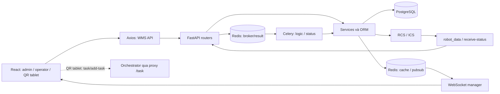

# Kiến trúc từ source code

Mức bằng chứng: **đọc code**, mốc 20/10/2026. Sơ đồ mô tả các đường kết nối có trong
source; không khẳng định tất cả thành phần đang chạy trên máy/server hiện tại.

## Các thành phần

Nguồn: [main.py](../backend/app/main.py), [celery_app.py](../backend/app/core/celery_app.py),
[robot_service.py](../backend/app/modules/robot/robot_service.py),
[ws_events.py](../backend/app/socket/ws_events.py),
[sendCallerAddTasks.ts](../frontend/src/utils/sendCallerAddTasks.ts).

## Frontend

Entry: [main.tsx](../frontend/src/main.tsx) → [App.tsx](../frontend/src/App.tsx) →
[routes/index.tsx](../frontend/src/routes/index.tsx).

- React + TypeScript + Vite; UI dùng Ant Design, wrapper tại `components/ui` và CSS/Tailwind.
- React Router chọn màn hình; `ProtectedRoute` kiểm tra trạng thái đăng nhập.
- `MainLayout` chọn `AdminLayout` hoặc `UserLayout` từ `user.access.is_admin`.
- `RoleGatePage` chọn component admin/operator cho một số route. Cùng `/import`
  có thể hiển thị `ImportPage` hoặc `OperatorInboundPage`.
- React Query lấy/cache dữ liệu và xử lý mutation; Zustand giữ phiên đăng nhập,
  kho đang chọn và trạng thái ứng dụng.
- Axios chung thêm Bearer token, xử lý refresh khi 401 và multipart upload.
- WebSocket cùng cơ chế invalidate query giúp cập nhật dữ liệu khi backend phát event.

Nguồn: [axiosInstance.ts](../frontend/src/api/axiosInstance.ts),
[useAuthStore.ts](../frontend/src/store/useAuthStore.ts),
[useAppStore.ts](../frontend/src/store/useAppStore.ts),
[MainLayout.tsx](../frontend/src/components/layout/MainLayout.tsx),
[useWarehouseWebSocket.ts](../frontend/src/hooks/useWarehouseWebSocket.ts).

## Backend

[main.py](../backend/app/main.py) tạo FastAPI, gắn router dưới `/api/v1`, cấu hình
CORS, metrics và vòng đời Redis/WebSocket. Khởi động app có `Redis.ping()`; không
thể kết luận API độc lập với Redis chỉ vì endpoint đang thử không gọi cache.

Quy ước tổ chức nhìn thấy trong source:

| Nhóm file | Vai trò |
| --- | --- |
| `*_api.py` | Route, tham số HTTP, dependency và chuyển kết quả/lỗi |
| `*_schema.py` | DTO/validation/response Pydantic |
| `*_service.py` | Nghiệp vụ, truy vấn, cập nhật dữ liệu và tích hợp |
| `*_model.py` | Model SQLAlchemy, quan hệ và một số trạng thái tính bằng biểu thức SQL |
| `*_celery_task.py` | Entry tác vụ nền, session và xử lý retry |
| `core` | Settings, DB session, cache, logger, bảo mật và Celery |

Đây là chỉ dẫn tìm file. Có nghiệp vụ nằm cả trong route/model; cần lần theo hàm
thực tế trước khi sửa. [Chỉ mục backend](index/backend.md) cho biết các khai báo.

## Worker và realtime

- `logic`: mặc định cho công việc nghiệp vụ, các nhóm `inbound.*`, `outbound.*`,
  `item.*`, `notification.*`, `dashboard.*`, `masan.*`.
- `status`: `robot.persist_task_status` xử lý phản hồi trạng thái robot.
- `run_logic_task`: khi `settings.debug` đúng, gọi `task.run` trực tiếp; còn lại
  gửi Celery và đợi kết quả với timeout được khai báo trong helper.
- Những nơi gọi `apply_async` trực tiếp không tự đi qua nhánh DEBUG này.
- Beat có lịch gán CC mỗi 5 giây và hai tác vụ hàng ngày lúc 11:59 theo cấu hình
  Celery. Vì vậy, bật worker/beat có thể bắt đầu xử lý nghiệp vụ.
- Event warehouse/sorting đi qua Redis pubsub để process API phát về WebSocket;
  FE nhận event và invalidate query liên quan.

Nguồn: [celery_app.py](../backend/app/core/celery_app.py),
[ws_manager.py](../backend/app/socket/ws_manager.py),
[ws_api.py](../backend/app/socket/ws_api.py),
[invalidateWarehouseRealtimeQueries.ts](../frontend/src/utils/invalidateWarehouseRealtimeQueries.ts).

## Xác thực và phạm vi kho

[auth_access.py](../backend/app/modules/auth/auth_access.py) xây `access` gồm
`is_admin`, các kho và module `inbound/outbound/stocktake`. Đây là dữ liệu cho FE.

[dependencies.py](../backend/app/core/dependencies.py) thực thi các dependency
backend. Hiện `require_permission` bỏ qua kiểm tra mã quyền với role `admin`
và role legacy `operator`; các role khác xét permission code. Ngoài ra có helper
`get_dev_admin_user` cho luồng tích hợp. Không suy ra mọi route có cùng cách bảo vệ.

Viewer kho có dependency riêng cho role `inbound` và kho được gán tại
[location_access.py](../backend/app/modules/warehouse/location_map/location_access.py).
Mô tả này phản ánh code hiện có, không phải kết luận phân quyền đã được kiểm toán.

## Khái niệm dữ liệu cần phân biệt

| Khái niệm | Ý nghĩa theo model |
| --- | --- |
| `Warehouse` | Kho nghiệp vụ |
| `Zone` | Khu thuộc kho |
| `Location.id` | ID DB của vị trí; khác `location_code` và `location_name` |
| `WarehouseMap` | Dữ liệu bản đồ liên quan kho/zone |
| `InboundOrder/Detail/Allocation` | Đơn nhập, dòng công việc và phân bổ hàng |
| `OutboundOrder/Detail/Allocation` | Đơn xuất, nhu cầu và phân bổ hàng/robot |
| `ItemStock` | Bản ghi tồn gắn item, location, unit và thông tin lot |
| `RobotTask` | Lệnh WMS với `order_id` và JSON `task_order_detail` |
| `TaskStatus` | Phản hồi trạng thái theo `order_id` |

Nguồn: các file `*_model.py` trong [bản đồ code](code-map.md). Một số trạng thái
được tính từ quan hệ/bảng trạng thái, không phải lúc nào cũng là cột có thể sửa
trực tiếp. DB đang triển khai và migration đã áp dụng chưa được xác minh trong đợt này.
