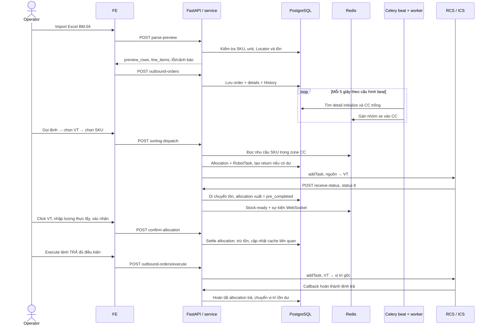

# Luồng xuất kho trong backend

Ngày khảo sát: **20/10/2026**. Mức bằng chứng: **đọc source hiện tại**, chưa chạy
luồng xuất trên DB/Redis/RCS thật. Trang này được viết mới, không dùng docs cũ.
Hướng dẫn bấm trên giao diện: [Thao tác outbound trên FE](../guides/outbound-fe.md).

Cập nhật code **21/10/2026**: tính phần chưa phân bổ, loại failed/cancelled khỏi
lượng đã xử lý, cho gọi bổ sung sau lỗi hoặc xuất một phần, giới hạn Locator
theo tồn khả dụng và báo lỗi khi không có task mới. Xem kiểm tra/áp dụng trong
[task lượng còn thiếu](../tasks/2026-10-21-outbound-remaining-quantity.md).

Tra nhanh: [sơ đồ](#4-sơ-đồ-luồng-masan), [tạo/import](#5-tạo-đơn-và-import-excel),
[phân bổ](#7-phân-bổ-tồn-theo-đơn), [dispatch](#8-operator-chọn-vt-và-sku-dispatch-masan),
[JSON RCS](#9-thực-thi-auto-và-json-gửi-rcs),
[xác nhận](#11-xác-nhận-lấy-hàng-và-chốt-tồn), [API](#14-bảng-api-và-quyền).

## 1. Phạm vi và cách đọc

Backend đang có hai đường xử lý liên quan nhau:

| Đường xử lý | Điểm vào FE | Vai trò |
| --- | --- | --- |
| Xuất theo đơn | Chi tiết `/export/:orderId`, QR tablet | Tạo đơn → chọn dòng → phân bổ tồn → thực thi → xác nhận |
| Xuất/chia chọn Masan | Operator `/export`, `/export/zone/:zoneId` | Import BM.04 → tự gán xe vào CC → chọn VT/SKU → điều phối pallet → xác nhận lượng lấy |

Masan dùng lại allocation, robot task và hàm thực thi của xuất theo đơn. Không
coi toàn bộ UI sorting-wave cũ là cùng một luồng với Masan; một số nút còn là
placeholder, được đánh dấu trong [hướng dẫn FE](../guides/outbound-fe.md).

Ba mốc cần phân biệt:

1. **Phân bổ:** giữ một phần tồn cho dòng xuất, chưa gửi robot.
2. **Robot hoàn thành vận chuyển:** pallet đã đến vị trí đích; allocation xuất
   chuyển `pre_completed`, chưa trừ lượng xuất khỏi tồn vật lý.
3. **Xác nhận lấy hàng:** chốt lượng xuất, trừ `ItemStock.quantity`; hàng dư có
   thể cần lệnh trả riêng.

## 2. Các file chịu trách nhiệm

| Source | Trách nhiệm |
| --- | --- |
| [outbound_order_api.py](../../backend/app/modules/warehouse/outbound_order/outbound_order_api.py) | Hợp đồng HTTP, quyền outbound, gọi task/service |
| [outbound_order_schema.py](../../backend/app/modules/warehouse/outbound_order/outbound_order_schema.py) | Payload tạo, calculate, execute và xác nhận |
| [outbound_order_service.py](../../backend/app/modules/warehouse/outbound_order/outbound_order_service.py) | Tạo/sửa/xóa đơn, chọn tồn, allocation, thực thi, settle, QR |
| [outbound_order_model.py](../../backend/app/modules/warehouse/outbound_order/outbound_order_model.py) | Đơn/dòng/allocation và trạng thái tính bằng SQL |
| [outbound_celery_task.py](../../backend/app/modules/warehouse/outbound_order/outbound_celery_task.py) | Task Celery bọc các nghiệp vụ xuất |
| [outbound_operator_board_service.py](../../backend/app/modules/warehouse/outbound_order/outbound_operator_board_service.py) | Bảng operator: đơn → xe → khách → trip → dòng hàng |
| [masan_api.py](../../backend/app/modules/masan/masan_api.py) | API Excel, CC/VT, dispatch, confirm, cache, báo cáo/PDF |
| [masan_outbound_service.py](../../backend/app/modules/masan/masan_outbound_service.py) | Import BM.04, gán CC, nhu cầu SKU, dispatch và stock-ready |
| [masan_sorting_return_service.py](../../backend/app/modules/masan/masan_sorting_return_service.py) | Đọc return sẵn sàng theo kho/VT và tồn thực tế, độc lập cache CC |
| [masan_oubound_auto_service.py](../../backend/app/modules/masan/masan_oubound_auto_service.py) | Xóa cache từng nhóm station, truy vấn robot theo zone VT; tên file hiện có thiếu chữ `t` |
| [masan_picking_list_service.py](../../backend/app/modules/masan/masan_picking_list_service.py) | Chọn dòng completed, gán lượt in `extracted`, dựng PDF |
| [robot_service.py](../../backend/app/modules/robot/robot_service.py) | Gửi ICS và nhận callback, chuyển vị trí tồn, phát dữ liệu chờ lấy |
| [item_stock_model.py](../../backend/app/modules/warehouse/item_stock/item_stock_model.py) | Tồn vật lý và tồn khả dụng sau giữ chỗ |
| [celery_app.py](../../backend/app/core/celery_app.py) | Queue logic, thực thi task và beat gán CC mỗi 5 giây |

## 3. Khái niệm và dữ liệu

| Khái niệm | Ý nghĩa trong source |
| --- | --- |
| `OutboundOrder` | Header: `order_code`, kho, người tạo, ghi chú và JSON `details` |
| `OutboundOrderDetail` | Dòng nhu cầu: item, quantity, tên đơn vị, `detail_type`, metadata xe/khách/trip/lot/locator |
| `OutboundOrderAllocation` | Một phần tồn dùng cho một detail: stock, lượng, đầu/đích, robot task, trạng thái và loại `outbound`/`return` |
| `ItemStock.quantity` | Lượng hàng vật lý của bản ghi tồn |
| `ItemStock.available_quantity` | `quantity` trừ allocation outbound có trạng thái khác `completed`, `failed`, `cancelled` |
| `OutboundOrderDetail.unallocated_quantity` | Nhu cầu trừ allocation outbound còn hiệu lực, gồm completed; bỏ failed/cancelled và return. Là biểu thức SQL, không cần migration |
| `RobotTask` | Lệnh vận chuyển; `order_id` chuỗi như `TDS_Outbound_...`, khác ID số của đơn xuất |
| `TaskStatus` | Các callback trạng thái robot được lưu; RobotTask lấy trạng thái từ dữ liệu liên quan trong model |
| CC | Ô chia chọn gắn với xe và các dòng cần lấy trong Redis |
| VT | Vị trí robot mang pallet đến để operator lấy/chia hàng |
| `sorting_location_id` | Vị trí CC được lưu về detail khi dọn assignment, dùng cho truy vết/PDF |
| `extracted` | Lượt tạo picking list; `0`/null là chưa gán lượt |

`warehouse_id`, `Zone.id`, `Zone.code`, `Location.id`, `location_name` và
`location_code` có vai trò khác nhau. API dispatch nhận `zone` là **mã CC**, còn
`to_location_id` là **ID vị trí VT**; JSON xuống RCS dùng **location_code**.

### Ánh xạ vùng operator hiện tại

Nguồn: [outboundMapZones.ts](../../frontend/src/constants/outboundMapZones.ts).
Đây là ánh xạ cố định trong FE; cần đối chiếu DB khi chuyển môi trường.

| URL | Tên hiển thị | Zone VT | Zone CC | `zone` gửi dispatch |
| --- | --- | --- | --- | --- |
| `/export/zone/9` | Khu vực chia chọn 1 | ID `9`, `Zone_sorting_2`, VT11–VT14 | ID `10`, `Zone_CC_01` | `Zone_CC_01` |
| `/export/zone/8` | Khu vực chia chọn 2 | ID `8`, `Zone_sorting_1`, VT21–VT24 | ID `11`, `Zone_CC_02` | `Zone_CC_02` |

Số `8`/`9` trên URL là display-zone/zone VT, không phải warehouse ID hay mã ô.
Đã đối chiếu READ ONLY với DB ngày 21/10/2026: số đuôi `Zone_sorting_*` khác
số trên tên khu hiển thị. FE đã sửa ánh xạ đảo để GET return/robot tasks hỏi
đúng khu; không đổi tên khu hay cặp VT–CC.

## 4. Sơ đồ luồng Masan



Sơ đồ thể hiện thứ tự nghiệp vụ chính, không có nghĩa các thay đổi DB/Redis/HTTP
nằm trong một transaction duy nhất. Một số service commit ở nhiều bước.

## 5. Tạo đơn và import Excel

### 5.1. Parse BM.04 chưa tạo đơn

`POST /api/v1/masan/outbound-orders/parse-preview` nhận multipart:
`file`, `warehouse_id`, `outbound_type`.

`parse_masan_outbound_rows` đọc worksheet đang active, tiêu đề ở hàng **2**, dữ
liệu từ hàng **3**; xử lý ô merge và carry một số giá trị. Cột `Mã Item` bắt buộc.
Cấu trúc mẫu nằm trong [masan_outbound_excel.py](../../backend/app/modules/masan/masan_outbound_excel.py):

`Số xe | Tên khách hàng | Trip | NVT | Mã Item | Tên Item | LOT | Lot status | Số lượng | Số pallet | Locator`.

`parse_masan_outbound_preview` kiểm tra kho, tìm SKU trong kho, số lượng, LOT và
Locator. Nếu có Locator, tìm vị trí active trong kho theo **name hoặc code**;
kiểm tra stock active, status `available`/`split`, đúng item và tổng
`available_quantity` đủ lượng yêu cầu.

Kết quả gồm `preview_rows`, `line_items`, `valid_rows`, `invalid_rows`, `warnings`,
`import_errors`, `can_import`. Lỗi Locator chặn import; các dòng lỗi khác có thể
bị loại khỏi `line_items`. FE còn có validation LOT riêng và có thể chặn trước
khi tạo đơn. Parse thành công chưa giữ tồn và chưa gửi RCS.

### 5.2. Lưu đơn

`POST /api/v1/outbound-orders?outbound_type=auto` gọi
`create_outbound_order_task` → `create_outbound_order`:

1. Tạo header và flush để có ID.
2. Kiểm tra `Unit.id` từng dòng, lưu tên unit vào detail.
3. Tạo detail cùng metadata JSON, áp quy tắc loại đơn.
4. Ghi History `initialize`, commit và trả header, HTTP **201**.

Ví dụ minh họa cấu trúc; mọi ID và mã hàng phải thay bằng dữ liệu thật trước khi
dùng trong một tác vụ vận hành được giao:

```json
{
  "order_code": "OUT-DEMO-001",
  "warehouse_id": 1,
  "note": "Import BM.04",
  "line_items": [
    {
      "item_id": 101,
      "quantity": 20,
      "unit_id": 1,
      "detail_type": "auto",
      "details": {
        "vehicle_no": "XE-DEMO",
        "customer_name": "KH-DEMO",
        "trip": "1",
        "lot_number": "201026"
      }
    }
  ]
}
```

FE tạo mã Excel dạng `OUT-YYYYMMDD-HHmmss`, chuẩn hóa lot ở từng dòng và **không
tự gán `order.details.type`** trong helper import. Metadata `details` cấp đơn
và `details` cấp dòng là hai đối tượng khác nhau.

### 5.3. Các loại đơn đặc biệt

`order.details.type` là quy tắc nghiệp vụ, khác `detail_type=auto/manual`:

| Loại đơn | Hành vi hiện tại |
| --- | --- |
| Thông thường | Lưu quantity yêu cầu; calculate mặc định strategy `fefo` |
| `Tuyển chọn`, `Lấy lỗi` và biến thể chữ thường có trong code | Khi tạo, quantity tính từ tồn phù hợp; calculate chuyển `re_qc`, cần `order.details.lot_number`, lọc khoảng lot giao nhau |
| `Lấy lẻ`, `lấy lẻ` | Quantity tính từ tồn split; ép detail manual, strategy `pick_split`, không tạo robot task khi phân bổ |

Không suy ra rằng nhập số lượng trên FE luôn là quantity được BE lưu ở các loại
đơn đặc biệt. Đối chiếu `_get_fixed_quantity`, `_resolve_outbound_detail_type`
và `_resolve_execute_detail_type` khi sửa quy tắc này.

## 6. Tự gán nhu cầu vào CC

Beat cấu hình `outbound.assign_cc_zone` mỗi **5 giây**, task duyệt các kho và gọi
`assign_cc_zone`. Tiến trình beat và worker phải thực sự hoạt động; chỉ API còn
chạy chưa đủ để có assignment mới.

Trong mỗi kho, service:

1. Đối chiếu các dòng completed trong DB và dọn Redis gán CC cũ, rồi đọc các CC còn được gán.
2. Tìm Location active thuộc các `settings.zone_cc` còn trống; sắp theo phần số
   của tên rồi theo tên.
3. Tìm order chưa completed và không có `details.cc_assignment_disabled=true`,
   detail có `unallocated_quantity > 0`, chưa có key assigned-detail.
4. Nhóm theo `details.vehicle_no`; thiếu số xe dùng `no_vehicle`.
5. Ghép nhóm xe với ô CC trống và ghi hai loại key không tự hết hạn.

Nhóm xe có thể chứa dòng từ **nhiều đơn**. Bucket giữ `outbound_order_id` của
dòng đầu; không coi bucket là quan hệ một-một giữa CC và một đơn. Từ bản sửa
21/10/2026, dọn theo trạng thái detail trong DB: bucket thiếu order đại diện vẫn
dọn được; bucket trộn nhiều đơn giữ các dòng chưa hoàn tất. Trước khi xóa cache,
tác vụ định kỳ lưu `sorting_location_id` còn thiếu cho báo cáo/picking list.
Thao tác Redis dùng so sánh và thay/xóa nguyên tử để không ghi đè lần gán mới.
Không dọn chỉ vì unallocated về 0; issued/pre_completed/thiếu lượng/return còn
chờ vẫn được giữ theo trạng thái detail. Callback có thể hoãn dọn tới lượt beat
5 giây tiếp theo nếu cần khôi phục lịch sử CC trước. Xem
[task sửa số xe](../tasks/2026-10-21-completed-cc-vehicle-cleanup.md).

Khi chủ dự án yêu cầu clear toàn bộ VT/CC để nhập phiên mới, phiên cũ được giữ
lịch sử và đặt `details.cc_assignment_disabled=true` kèm metadata `station_reset`.
Flag chỉ ngăn tự gán CC; không đánh dấu đã xuất đủ hay tự sửa quantity của đơn.
Phiên mới không có flag nên vẫn tự gán bình thường. Đây là metadata bảo trì,
chưa có nút đóng/mở lại trong FE. Xem
[reset toàn bộ VT/CC ngày 21/10](../tasks/2026-10-21-full-vt-cc-reset.md).

| Key logic trong service | Nội dung |
| --- | --- |
| `outbound:assigned_cc_location:{warehouse_id}:{cc_location_id}` | Zone CC, xe, order đại diện, danh sách lines/detail/quantity |
| `outbound:assigned_cc_details:{warehouse_id}:{detail_id}` | Zone CC và CC location của detail |
| `outbound:masan:stock_ready:{warehouse_id}:{cc_zone}:{allocation_id}:{cc_location_id}` | Allocation robot đã mang đến, chờ lấy hoặc dữ liệu cập nhật sau xác nhận |

Đây là key trước prefix do [core/cache.py](../../backend/app/core/cache.py) áp
dụng. Không suy ra tên key vật lý chỉ từ chuỗi trong service. Các assignment và
stock-ready dùng TTL `-1` tại nơi ghi, khác snapshot telemetry robot có TTL.

`get_sorting_data_for_zone` đọc bucket và bổ sung trạng thái/SKU từ DB.
`get_item_needed_to_sorting` gom **unallocated_quantity** theo item trong zone:
không gọi trùng phần đã completed hoặc đang có allocation còn hiệu lực, vẫn
tính lại phần từng failed/cancelled vào lượng cần gọi.

## 7. Phân bổ tồn theo đơn

`POST /api/v1/outbound-orders/calculate?strategy=fefo` →
`calculate_outbound_order_task` → `calculate_outbound_order`.

```json
{
  "warehouse_id": 1,
  "outbound_order_id": 200,
  "line_items": [
    {"id": 201, "item_id": 101, "quantity": 20, "unit_id": 1, "detail_type": "auto"}
  ]
}
```

`line_items[].id` là **detail ID đã có**, không phải item ID. Service kiểm tra:
danh sách không rỗng, detail không trùng, đúng order/kho/item, lượng xin phân bổ
không vượt phần còn lại sau allocation outbound còn hiệu lực; failed/cancelled
không được coi là đã đáp ứng nhu cầu.

`_strategy_loading_stocks` chọn stock active có `available_quantity > 0`, item
phù hợp, zone thuộc `settings.zone_storage`. Các nhánh strategy:

| Strategy | Thứ tự/lọc thực tế |
| --- | --- |
| `fefo` | `available` trước `split`, rồi ngày lot-from, lot-to, thời gian tạo, ID; lot không đọc được dùng thời gian tạo làm khóa dự phòng |
| `re_qc` | Khoảng lot giao với lot yêu cầu, status available/split; xếp theo lot-from, lot-to, ID |
| `pick_split` | Chỉ status split, xếp thời gian tạo rồi ID |

Tên `fefo` hiện **không có nghĩa sort theo `expiry_date`**. Predicate của helper
chọn stock chưa có `warehouse_id` tường minh; xem mục cần xác minh bên dưới.

`greedy_allocate_stocks_to_lines` lấy dần từ stock khả dụng sang từng dòng,
tạo allocation loại `outbound`. Nếu auto, tạo hoặc dùng lại RobotTask theo vị
trí nguồn; task có path tạm `None`, quantity là tổng tồn vật lý của vị trí.
Việc tìm task đang initialize theo nguồn hiện không giới hạn một đơn.

Manual/Lấy lẻ tạo allocation với `robot_task_id=null`. Phân bổ không làm giảm
`ItemStock.quantity`; lượng khả dụng giảm do biểu thức tính từ allocation.

Không có stock phù hợp gây lỗi; có stock nhưng thiếu lượng có thể phân bổ một
phần. Kết quả chứa `is_fully_allocated` và `lacked`. Helper `lacked_details` hiện
xét cả detail chưa có allocation; failed/cancelled không làm mất phần còn
thiếu. Quy tắc này cập nhật ngày 21/10/2026.

## 8. Operator chọn VT và SKU: dispatch Masan

FE [useMasanVtSortingDispatch.ts](../../frontend/src/hooks/useMasanVtSortingDispatch.ts)
gửi một SKU được chọn và VT đích:

```http
POST /api/v1/masan/outbound-orders/sorting-dispatch
```

```json
{
  "warehouse_id": 1,
  "zone": "Zone_CC_01",
  "item_id": 101,
  "to_location_id": 301
}
```

`sending_masan_outbound_task` xử lý theo thứ tự:

1. Đọc CC bucket đúng zone/SKU, kiểm tra detail đúng kho/item, khóa detail và
   đọc lại phần chưa phân bổ. Hỗ trợ dòng failed hoặc đã xuất một phần.
2. **Có Locator:** match name hoặc code trong kho, khóa vị trí/stock, chỉ lấy
   stock active available/split còn khả dụng. Dùng greedy allocator để cấp
   đúng lượng còn thiếu, có thể chia qua các stock trong cùng Locator, không
   vượt tổng tồn khả dụng hoặc dùng lại stock đã clear.
3. **Không Locator:** nhóm theo order rồi calculate `fefo` với phần chưa phân bổ.
4. Chọn allocation xuất initialize đầu tiên có robot task theo ID; gom các
   allocation initialize cùng task.
5. `_pack_and_execute_robot_task` điều chỉnh quantity trong bucket CC và gọi
   `execute_outbound_task` với nguồn từ allocation (nếu trống mới lấy
   `stock.location_id`), VT được chọn và các allocation ID. Execute kiểm tra
   nguồn này còn khớp vị trí thực của stock.

Một lần dispatch thực thi **một robot task/pallet nguồn**, dù nhu cầu SKU có
nhiều dòng hoặc nhiều pallet. Không có vòng lặp tự gửi hết mọi task trong hàm
này. `_apply_clear_outbound_masan_details` điều chỉnh bucket trước execute; khi
new-lines rỗng, đoạn xóa bucket đang comment, nên không hiểu bước này là đã
giải phóng hoàn toàn CC.

Response `{warehouse_id, zone, item_id, lacked}` chưa chứng minh robot đã chạy
xong. Không có task để gửi hoặc Locator không có tồn khả dụng hiện trả **400**;
không còn biến None thành thành công giả. `lacked` gồm phần chưa phân bổ ở cả
nhánh Locator và nhánh calculate. Vẫn đối chiếu task/log/callback khi vận hành.

## 9. Thực thi auto và JSON gửi RCS

`POST /api/v1/outbound-orders/execute?detail_type=auto` nhận:

```json
{
  "order_id": "TDS_Outbound_a1b2c3d4",
  "from_location_id": 300,
  "to_location_id": 301,
  "allocations": [{"allocation_id": 401}]
}
```

Ở đây `order_id` là **RobotTask.order_id chuỗi**, khác
`outbound_order_id=200` trong calculate. `execute_outbound_task`:

1. Resolve detail type; Lấy lẻ chuyển nhánh manual.
2. Kiểm tra nguồn tồn tại, không empty/in_transit, task initialize.
3. Kiểm tra từng allocation thuộc task và initialize; với outbound, nguồn phải
   đúng vị trí stock hiện tại.
4. Gán đầu/đích, đổi allocation sang `issued`, dựng path bằng location_code.
5. Nếu quantity pallet/task lớn hơn lượng lấy, tạo **task và allocation return
   ngay lúc gửi xuất**, path đảo ngược, status initialize. Bước này chưa gửi trả.
6. Ghi History, gọi `TaskStatusService.create_robot_task`, commit hoặc rollback
   theo nhánh lỗi.

JSON gửi đến `ICS_ADD_TASK_PATH` có cấu trúc:

```json
{
  "orderId": "TDS_Outbound_a1b2c3d4",
  "priority": 4,
  "modelProcessCode": "<settings.outbound_process_code>",
  "fromSystem": "Thadosoft",
  "taskOrderDetail": [{"taskPath": "MA_O_NGUON,MA_O_VT"}]
}
```

`outbound_process_code` mặc định trong schema config là `out_storage`; lệnh trả
dùng `inbound_process_code` mặc định `to_storage`. Cấu hình môi trường có thể
ghi đè; không suy ra process-code thực tế từ mặc định. Luồng outbound này chưa
truyền lựa chọn `assignRobotIds` như chức năng chọn robot nhập kho.

Client HTTP timeout 5 giây, log request/response theo `orderId`, kiểm tra HTTP
status và đọc JSON. Chưa thấy xác thực code nghiệp vụ của response RCS. Task
execute Celery có retry lỗi ICS retryable, tối đa 3 lần, delay 10/20/40 giây;
đường gọi trực tiếp trong dispatch Masan không đi qua task execute này.

## 10. Callback và hàng chờ lấy tại VT

`POST /api/v1/receive-status` → task lưu trạng thái →
`TaskStatusService.receive_task_status`. Callback cần `orderId` khớp RobotTask.
Các trường được đọc gồm `status`, `deviceNum`, `deviceCode`, `subTaskStatus`,
`qrCode`, `shelfNumber`.

| RCS `status` | Trạng thái map |
| --- | --- |
| `6` | `in_progress` |
| `7` | `failed` |
| `3` | `cancelled` |
| `8` | `completed` |

Nguồn mapping: [robot_model.py](../../backend/app/modules/robot/robot_model.py).
Với allocation xuất, `8` được chuyển thành **`pre_completed`**; với allocation
return thì thành `completed` và settle theo nhánh return.

Khi hoàn thành vận chuyển, BE chuyển **mọi stock active ở vị trí nguồn** sang
đích từ allocation đầu tiên, không chỉ một SKU. `_send_taking_stock` chỉ xử lý
nhóm outbound: ghi thời gian bắt đầu chia, đọc assignment CC của detail, cache
payload stock-ready và publish `masan.sorting.stock_ready`.

FE đọc pending-stock, kết hợp CC assignment để biết pallet tại VT phục vụ các
CC/xe nào. Stock-ready phụ thuộc metadata assigned-detail còn tồn tại; callback
robot đơn thuần không bảo đảm UI có đủ CC context nếu cache đã bị xóa.

Endpoint callback trả `{"code":1000}` cả một số trường hợp không xử lý, như
thiếu `orderId` ở router hoặc task đã completed. ACK không thay thế kiểm tra
DB/log. Callback, snapshot `/robot_data` và trạng thái đơn là ba loại dữ liệu khác nhau.

## 11. Xác nhận lấy hàng và chốt tồn

Operator tab xuất click **VT** → modal “Xác nhận lấy hàng tại VT” (gom allocation
mọi CC cùng VT). Tab monitor click **CC** → cùng API, `quantities` chỉ allocation
thuộc ô CC đó. Cả hai gọi
`POST /api/v1/masan/outbound-orders/confirm-allocation`:

```json
{
  "warehouse_id": 1,
  "zone": "Zone_CC_01",
  "quantities": {"401": 20, "402": 10},
  "sorting_persons": "nv_a, nv_b"
}
```

`sorting_persons`: username người xuất (operator); FE lấy từ ô chọn trên Monitor
(theo khu), nhiều người nối bằng dấu phẩy → `outbound_order_allocation.sorting_persons`.

Key của `quantities` là **allocation ID**, không phải detail ID. Schema ép key
và value thành integer, quantity phải >0. FE bỏ dòng có lượng 0 và chặn lượng
lớn hơn lượng đang hiển thị; không coi validation FE là toàn bộ validation BE.

`confirm_allocation_outbound`:

1. Tìm đủ allocation ID; đặt tạm `confirmed`, cập nhật cache/event stock-ready,
   ghi thời gian kết thúc chia nếu điều kiện thời gian thỏa mãn.
2. Kiểm tra allocation outbound cùng detail còn pending bằng SQL `.notin_`
   (bỏ completed/confirmed/failed/cancelled); khi hết pending và không còn thiếu lượng gọi
   `_clear_cache_details`, ghi `sorting_location_id` và dọn assignment detail/CC.
3. Nếu quantity xác nhận khác lượng allocation, cập nhật allocation và điều
   chỉnh detail theo công thức hiện có; xem mục cần xác minh.
4. Gọi `_settle_outbound_stock`: đổi allocation `completed`, trừ lượng xuất
   khỏi `ItemStock.quantity`, ghi Transaction/History/thông báo, commit.
5. Nếu có thay đổi lượng, tạo/cập nhật return allocation cho stock dư; commit
   trước khi đối chiếu/dọn lại các assignment completed trong kho.
6. API đọc lại và trả `allocation_statuses`, `detail_statuses` cùng các trường
   đại diện; phải đọc trạng thái từng detail khi có nhiều dòng.

Ví dụ bình thường: pallet 100, phân bổ lấy 30 → sau callback tồn vật lý vẫn 100
nhưng ở VT; xác nhận đủ 30 → tồn vật lý còn 70; task return 70 chờ thực thi.
Đây là ví dụ diễn giải từ code, chưa là test đã chạy.

### Những đường xác nhận khác

| API | Khi dùng | Phạm vi settle |
| --- | --- | --- |
| `POST /outbound-orders/id/{id}/confirm-qr` với `qr_code` | QR tablet xác nhận hàng đã đưa đến | Allocation outbound `pre_completed` của stock gắn QR trong đơn đó |
| `POST /outbound-orders/confirm-no-qr` với `order_id` chuỗi | Nút Xác nhận ở task auto trên chi tiết đơn | Allocation outbound `pre_completed` thuộc robot task |
| `POST /outbound-orders/execute?detail_type=manual` | Xuất manual theo allocation | `_execute_outbound_task_manual`, không gửi RCS, settle trực tiếp theo nhánh này |
| `POST /outbound-orders/execute-qr-manual` | Chuỗi quét QR thủ công | Các allocation trong danh sách ID được gửi |

Các path trong bảng có prefix `/api/v1`. Response confirm có trường
`status="completed"` không có nghĩa mọi detail/return của cả đơn đã completed.
`overall` và `return_quantity` lấy từ kết quả settle; helper hiện trả lượng tồn
của **stock cuối vòng lặp**, không phải tổng mọi pallet dư.

### QR manual: ba lần quét theo trạng thái

1. `initialize` + QR hàng hợp lệ → `pre_completed`; có kiểm tra item/lot và
   lượng, có thể đổi stock allocation sang stock đã quét phù hợp.
2. `pre_completed` + mã vị trí đích → `double_check_stock`; kiểm tra đích phù hợp.
3. `double_check_stock` + QR đúng stock → `completed`, chuyển stock đến đích,
   trừ lượng và ghi Transaction.

Nhánh này có logic riêng trong `execute_qr_manual`, không gọi chung toàn bộ hàm
settle như confirm Masan. Bấm/scan khác thứ tự có thể bị từ chối theo trạng thái.

## 12. Hàng dư và lệnh trả

Return allocation liên kết detail/stock và robot task riêng `TDS_Return_...`.
Không trừ tồn thêm khi settle return: đây là chuyển vị trí hàng dư, không phải
xuất lần hai.

Từ 21/10/2026, operator đọc
`GET /api/v1/masan/outbound-orders/sorting-zone/return-tasks?warehouse_id=…&zone=…`.
`zone` là **mã khu VT**, không phải mã khu CC. API yêu cầu `outbound:read`,
trả `{warehouse_id, zone, rows: [{outbound_order_id, task}]}` và chỉ đọc DB.
[Service return](../../backend/app/modules/masan/masan_sorting_return_service.py)
chọn task khi:

- RobotTask và toàn bộ allocation return còn `initialize`.
- Tồn active, quantity dương, đang ở đúng VT nguồn; lượng trả dương và không
  vượt tồn. Đầu/đích cùng kho, toàn bộ allocation dùng cùng cặp vị trí.
- Có outbound completed của từng detail/stock đến đúng VT; không còn outbound
  chờ/chạy/xác nhận trên detail hoặc cùng stock tại VT. Attempt failed/cancelled
  cũ không chặn return sau retry thành công.

FE dùng [useMasanSortingZoneReturnTasks.ts](../../frontend/src/hooks/useMasanSortingZoneReturnTasks.ts)
đọc mỗi 5 giây khi modal mở. Việc dọn assignment CC không làm mất nguồn tìm
return. API giữ đủ allocation của task kể cả khi liên quan nhiều đơn; FE dùng
[buildReturnExecuteBody](../../frontend/src/utils/masanSortingReturnTasks.ts)
để gửi đúng orderId của robot task và from/to qua endpoint Execute hiện có.
Tra cứu không tạo task, không sửa tồn, không tự gửi RCS.

## 13. Trạng thái đơn, dòng, allocation và robot

| Đối tượng | Cách có trạng thái |
| --- | --- |
| Allocation | Cột được service/callback cập nhật trực tiếp |
| Detail | SQL expression từ tổng quantity allocation không phải return và trạng thái các allocation liên quan |
| Order | SQL expression tổng hợp trạng thái các detail |
| RobotTask | SQL expression từ TaskStatus mới nhất theo created_at/ID, map mã RCS; chưa có hoặc mã chưa biết là initialize. FE còn tổng hợp allocation để chọn trạng thái/nút |

Trạng thái allocation thường gặp: `initialize` → `issued` → `in_progress` →
`pre_completed` → `completed`; nhánh manual có `double_check_stock`, confirm
Masan có `confirmed` tạm thời; callback lỗi có `failed`/`cancelled`.

Detail có các trạng thái `initialize`, `reserved`, `in_progress`, `completed`.
Failed/cancelled outbound không tính vào lượng đáp ứng hoặc giữ detail trong
trạng thái đã xử lý; cancelled return không chặn hoàn tất. Failed return vẫn
cần xử lý, không tự coi là trả thành công.
Không có allocation là initialize; có initialize có thể reserved; thiếu lượng
hoặc trạng thái đang xử lý có thể in_progress; tất cả allocation completed và
đủ điều kiện quantity mới completed. **Return bị loại khỏi tổng lượng phân bổ,
nhưng vẫn được xét trong các điều kiện tồn tại/trạng thái allocation.** Vì vậy
return chưa xong có thể giữ detail/order chưa completed.

Order toàn detail initialize/reserved/completed lần lượt cho trạng thái đó;
tổ hợp trạng thái khác hoặc có detail in_progress cho in_progress. Đọc biểu
thức trong model khi điều tra, không chỉ đọc `History.new_status` hoặc toast FE.

## 14. Bảng API và quyền

Mọi path dưới đây có prefix `/api/v1`. Quyền thực tế do dependency tại endpoint
và cơ chế auth hiện có quyết định; role hiển thị FE không thay thế kiểm tra BE.

| Nhóm | Method và path | Quyền/ý nghĩa |
| --- | --- | --- |
| Tạo đơn | `POST /outbound-orders?outbound_type=...` | `outbound:create` |
| Danh sách | `GET /outbound-orders` | `outbound:read`, lọc theo kho và các query hiện có |
| Chi tiết | `GET /outbound-orders/id/{id}`, `GET /outbound-orders/id/{id}/details`, `GET /outbound-orders/id/{id}/lacked` | `outbound:read` |
| Task | `GET /robot-tasks/{order_id}`, `GET /manual-allocation-tasks/{order_id}` | `outbound:read`; ID đơn xuất dạng số, khác body execute |
| Phân bổ | `POST /outbound-orders/calculate` | `outbound:update` |
| Thực thi/xác nhận | `POST /outbound-orders/execute`, `/confirm-no-qr`, `/execute-qr-manual`, `/id/{id}/confirm-qr` | `outbound:update` |
| Sửa | `PATCH /outbound-orders/id/{id}?outbound_type=...` | `outbound:update`; BE chỉ cho order initialize |
| Xóa | `DELETE /outbound-orders/{order_code}` | `outbound:delete`; mặc định không cho completed |
| Parse Excel | `POST /masan/outbound-orders/parse-preview` | `outbound:create`; chưa tạo đơn |
| CC | `GET /masan/outbound-orders/cc-locations/{location_id}` và `/sorting-zone/cc-locations` | `outbound:read`; warehouse/zone query theo endpoint |
| Nhu cầu | `GET /masan/outbound-orders/sorting-items-needed` | `outbound:read`; warehouse + mã CC |
| Dispatch | `POST /masan/outbound-orders/sorting-dispatch` | `outbound:update` |
| Hàng chờ | `GET /masan/outbound-orders/sorting-zone/pending-stock` | `outbound:read`; warehouse + mã CC |
| Robot theo VT | `GET /masan/outbound-orders/sorting-zone/robot-tasks` | `outbound:read`; query zone là mã VT |
| Return sẵn sàng | `GET /masan/outbound-orders/sorting-zone/return-tasks` | `outbound:read`; warehouse_id + mã VT; độc lập cache CC |
| Chốt lượng | `POST /masan/outbound-orders/confirm-allocation` | `outbound:update` |
| Bắt đầu chia | `POST /masan/outbound-orders/start-sorting-time` | `outbound:update`; stamp `start_sorting_time` một lần, trả giờ đã có nếu đã ghi |
| Dọn cache | `POST /masan/outbound-orders/clear-station-cache`, `/clear-cc-cache` | `outbound:update`; thao tác ghi Redis |
| SO | `GET /masan/outbound-orders/{id}/export-so` | `outbound:read` |
| Báo cáo | `GET /masan/outbound-orders/{id}/export`, `POST /masan/outbound-orders/export` | `outbound:read`; bulk nhận danh sách order ID |
| Picking list | `GET /masan/outbound/picking-lists`, `GET /masan/outbound/picking-lists/pdf` | `outbound:read` |
| Tạo lượt PDF | `POST /masan/outbound/picking-lists` | `outbound:update`; có ghi lượt `extracted` |
| Callback | `POST /receive-status` | Webhook tích hợp hiện có, không dùng JWT người dùng như API FE |

Operator-board GET dùng chuỗi route:
`/outbound-orders/operator-board/orders` →
`/outbound-orders/{id}/operator-board/vehicles` →
`.../vehicles/{vehicle_key}/customers` →
`.../customers/{customer_key}/trips` →
`.../trips/{trip_key}/lines`.
Đây là đường đọc/browse; lựa chọn một xe trên bảng không tự gửi lệnh robot.

Chi tiết hợp đồng và handler: [chỉ mục API](../index/api.md). Validation schema
thường cho 422; ValueError nghiệp vụ thường map 400/404. Execute generic map lỗi
ICS thành 502/503; không giả định mọi endpoint Masan có cùng cách map lỗi.

## 15. Worker, cache, cập nhật FE và báo cáo

`run_logic_task`: `settings.debug=true` gọi `task.run` trong API process; khi
false, enqueue rồi `.get(timeout=...)` chờ kết quả. HTTP trả về không có nghĩa
luồng robot đã chạy xong. Routing `outbound.*` đi queue logic; beat gán CC là
tác vụ nền độc lập. Xem [runtime](../runtime.md) khi kiểm tra phiên bản worker.

FE CC locations poll mỗi 5 giây; pending-stock hiện **không poll định kỳ**, dựa
vào WebSocket `masan.sorting.*`, invalidation và các lần refetch khi thao tác
map. Robot tasks theo các order CC có poll 5 giây. Vì vậy chỉ nhìn một bảng tự
cập nhật không chứng minh mọi dữ liệu trên map đã được làm mới.

`clear-station-cache` nhận `{warehouse_id, cc_location_ids}` và xóa bucket,
assigned-detail liên quan/orphan, stock-ready của các CC đó. `clear-cc-cache`
dọn toàn bộ ba prefix theo kho. **Không xóa đơn/allocation DB hay hủy lệnh RCS**;
beat có thể gán lại CC theo trạng thái DB.

Picking list chỉ lấy detail **completed** theo xe. `GET /masan/outbound/picking-lists`
trả thêm `available_lines` (mọi dòng completed của xe trong kho) để UI tick in tùy chọn.
`POST /masan/outbound/picking-lists` với `detail_ids` không rỗng: in subset, mã biểu mẫu
«In chọn lọc», **không** ghi `extracted`. POST không `detail_ids` (hoặc rỗng): tạo lượt mới —
các dòng chưa in, kiểm tra kho/vị trí CC, gán `extracted=max+1`, commit. Tải lượt cũ:
`GET .../picking-lists/pdf?extracted=`. Vì tạo lượt in có ghi DB, POST tạo lượt không phải GET thuần.
PDF A4 **ngang** ([`template_picking_list_a4.html`](../../backend/app/static/templates/template_picking_list_a4.html));
payload inject `sheets[]`: gom dòng theo `customer_name` trong JSON `details`
(rỗng → `Unknown`), mỗi khách một block meta + bảng (page-break giữa các khách).
Meta (chữ lớn): biển số, ngày, ô CC, mã biểu mẫu, **khách hàng**, **NVT**, **Trip**
(NVT/trip unique theo thứ tự trong nhóm khách; trip fallback `trip_code`). Bảng 7 cột:
STT, mã hàng, tên, lô, SL, ĐVT, locator. Số trang liên tục cả file; chữ ký «Người chia hàng»
chỉ trang cuối PDF. Render qua service riêng (Playwright); lỗi render không nên được
suy diễn là chưa từng gán lượt in, vì việc gán lượt đã có commit trước bước render.

Sửa đơn chỉ khi initialize; xóa đơn gọi purge các quan hệ/cache/history theo
service và bị chặn với completed. Không dùng xóa đơn hay dọn cache như lệnh
hủy robot: các thao tác đó không cùng hợp đồng với RCS.

Mẫu Excel SO trong [masan_outbound_so_excel.py](../../backend/app/modules/masan/masan_outbound_so_excel.py)
được cập nhật ngày **21/10/2026**: in A4 dọc, fit một trang theo chiều ngang,
không ép toàn bộ dữ liệu vào một trang theo chiều dọc; lặp hàng 1–6. Chân trang
phải có **Người chia hàng**, **(Ký, ghi rõ họ tên)** và khoảng trống ký tên.
Lề dưới dành riêng cho chữ ký, footer không co theo bảng và áp dụng mỗi trang
của từng sheet khách hàng. Đây là chân trang in, xem trong Print Preview/Page
Layout; không phải dòng dữ liệu bổ sung trong bảng hàng.

## 16. Các điểm cần xác minh trước khi thay đổi nghiệp vụ

Cập nhật **21/10/2026**: đã kiểm tra và xử lý dữ liệu thật của một ca VT13,
đơn 29: 8 allocation confirmed tổng 204 trong khi stock còn 198; Redis không
còn cache outbound. Đã chuyển 8 allocation lỗi sang failed và vô hiệu hóa
stock lỗi để kiểm kê, giữ phần khác. Xem [hồ sơ VT13](../tasks/2026-10-21-vt13-outbound-recovery.md).
Code nghiệp vụ chưa sửa; các quan sát dưới đây vẫn cần kiểm chứng theo từng
tình huống, không coi xử lý dữ liệu là đã ngăn lỗi tái diễn.

Các mục khảo sát ban đầu dưới đây là quan sát tĩnh. Theo dõi thêm ở
[questions.md](../questions.md), mục Q14–Q19.

| Quan sát trong source | Ý nghĩa cần kiểm chứng |
| --- | --- |
| `_strategy_loading_stocks` còn cần kiểm chứng warehouse scope; nhánh Locator đã bổ sung kho/active/khả dụng/name-code và khóa cấp phát ngày 21/10 | Tiếp tục kiểm chứng concurrency PostgreSQL và các tổ hợp kho/lot |
| `_check_stock_in_task` không lọc order; callback chuyển tất cả stock active tại nguồn; return gắn stock/detail cuối | Các tổ hợp nhiều SKU, nhiều order cùng pallet/vị trí và lượng return cần test riêng |
| Đã sửa ngày 21/10: lacked xét mọi detail, sorting-needed dùng unallocated_quantity, failed/cancelled không tính đã đáp ứng, không có task trả 400 | `lacked=[]` vẫn chưa chứng minh robot đã hoàn thành; đối chiếu callback |
| Đã sửa 21/10: `still_pending` dùng SQL `.notin_(...)`, thêm kiểm tra lượng còn thiếu; có lượt dọn CC completed định kỳ | Có test xác nhận dòng cuối, dòng khác còn pending, bucket thiếu order đại diện và bucket trộn nhiều đơn; xem task sửa số xe |
| Confirm lượng khác allocation đặt `allocation.quantity=q`, `detail.quantity=detail.quantity-q`, commit nhiều lần; BE chưa thể hiện đầy đủ các chặn quantity/status/kho tương ứng FE | Cần chốt công thức xuất thiếu, kiểm tra xác nhận lặp/sai kho/sai lượng và tính nguyên tử |
| `_settle_outbound_stock` ghi Transaction.quantity bằng lượng stock sau trừ, trả leftover của stock cuối; trạng thái detail còn xét return | Cách diễn giải báo cáo, completion và lượng hàng dư phải đối chiếu DB; History completed chưa chứng minh toàn bộ order completed |
| Đã sửa 21/10: Return modal lấy từ DB theo kho/VT, không suy order từ CC | 11 test BE cách ly và đối chiếu READ ONLY lệnh VT14 → G366; chưa phát robot thật để nghiệm thu |
| ICS client kiểm tra HTTP nhưng chưa thấy kiểm tra business-code; generic execute có retry, dispatch Masan gọi trực tiếp | Cần xác minh ACK, idempotency và lỗi sau khi RCS đã nhận nhưng DB/HTTP chưa hoàn tất |

## 17. Cách lần lỗi theo mốc

| Hiện tượng | Điểm kiểm tra trước |
| --- | --- |
| Import không ra đơn | Request parse-preview, lỗi LOT/Locator/SKU, `can_import`, rồi request tạo đơn riêng |
| Có đơn nhưng CC trống | Detail status, số xe, zone CC/cấu hình, worker+beat, prefix Redis và assigned keys |
| SKU không có trong popup | Đúng kho, đúng mã CC, assignment còn tồn tại, detail còn trạng thái phù hợp |
| Gọi lệnh nhưng không có request RCS | Xác định đúng nút FE, response dispatch, allocation initialize/robot task, vị trí nguồn, log `ICS addTask request` |
| Có request nhưng robot không chạy | Response RCS theo cùng orderId, business-code, process-code, taskPath, log kết nối và callback |
| Robot đã đến nhưng không có hàng chờ | Callback `8`, allocation pre_completed, stock location, assigned-detail, stock-ready và WebSocket |
| Xác nhận xong đơn chưa completed | Quantity detail/allocation, allocation return còn initialize, biểu thức trạng thái trong model |
| Không thấy return | Đúng kho/mã VT, task và allocation còn initialize, tồn active còn tại VT, outbound liên quan đã completed, from/to hợp lệ |

Các bước trên là tra cứu/đối chiếu. Không tự phát lại lệnh cũ để thử kết nối.

## 18. Kịch bản kiểm chứng cho lần phát triển tiếp theo

Chưa chạy trong tác vụ tài liệu. Dùng dữ liệu kiểm thử và tích hợp giả lập khi
có yêu cầu sửa code:

1. Import hợp lệ, SKU sai, LOT sai, Locator không có/thiếu/khác SKU; kiểm tra
   parse không tạo đơn và tạo đơn không tự gửi robot.
2. Allocation đủ/thiếu/không có tồn, hai kho cùng zone code, nhiều stock/lots;
   kiểm tra không over-allocate và thiếu được báo đủ.
3. Một SKU nhiều order cùng xe, nhiều xe, nhiều SKU cùng vị trí; kiểm tra task
   được gom đúng và một dispatch gửi đúng phạm vi.
4. Auto: gửi → callback đang chạy → callback hoàn thành → confirm đủ lượng →
   return; kiểm tra từng mốc quantity/available/location/status/cache.
5. Confirm ít hơn phân bổ, confirm lặp, ID sai kho/zone, allocation sai trạng
   thái, Redis lỗi và callback lặp; kiểm tra DB/cache không lệch sau lỗi.
6. Manual/Lấy lẻ, ba bước QR, sai item/lot/đích; xác minh không gọi RCS.
7. PDF tạo mới/tải cũ, render lỗi sau commit, CC nhiều order và return không
   còn trên modal; kiểm tra lượt in và truy vết nguồn dữ liệu.

Hướng dẫn thao tác cụ thể và bảng đối chiếu nút FE nằm ở
[outbound-fe.md](../guides/outbound-fe.md).
