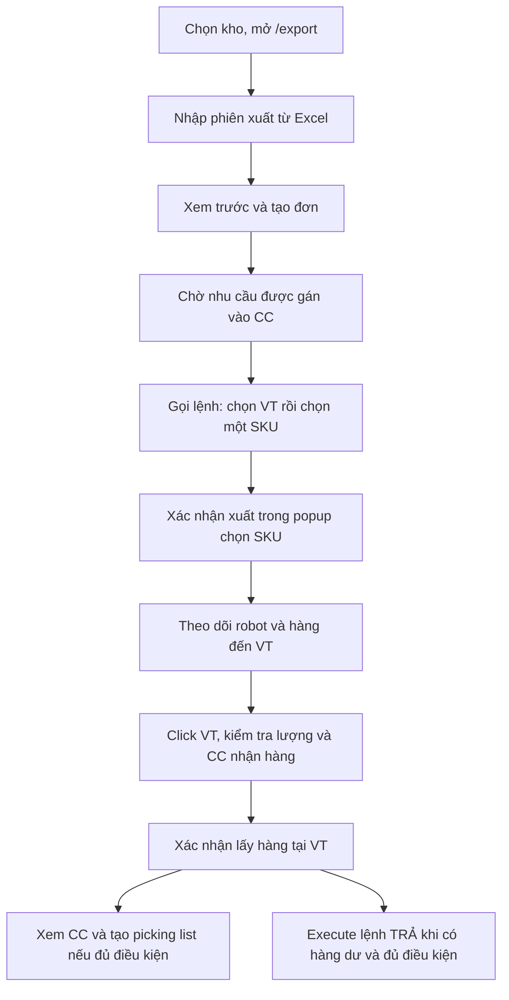

# Hướng dẫn thao tác xuất kho trên FE

Ngày khảo sát: **20/10/2026**. Viết từ router, page, component và API đang có
trong source; chưa chạy nghiệm thu trên giao diện/RCS thật. Dành cho chủ dự án
tự thao tác và làm việc với Codex. Docs cũ không được dùng làm nguồn.

Luồng BE, trạng thái, JSON và cache: [outbound.md](../flows/outbound.md).

Tra nhanh: [operator](#2-luồng-operator-thường-dùng), [admin](#3-luồng-admin-theo-đơn),
[manual/QR](#4-manual-lấy-lẻ-và-qr-tablet), [nút và API](#5-bảng-nối-nút-fe-với-api),
[tra lỗi](#7-tra-lỗi-theo-hiện-tượng).

## 1. Chọn đúng màn hình

| Tài khoản/route | Màn hình | Dùng để làm gì |
| --- | --- | --- |
| Admin `/export` | Quản lý Xuất kho | Danh sách, tìm/lọc, tạo và import đơn |
| Operator `/export` | Đơn xuất và chia chọn | Hai khu chia chọn, nhập phiên Excel, gọi lệnh theo VT/SKU |
| `/export/zone/9` | Khu vực chia chọn 1 | Map VT zone 9 và CC zone 10 |
| `/export/zone/8` | Khu vực chia chọn 2 | Map VT zone 8 và CC zone 11 |
| `/monitor`, `/monitor/zone/:zoneId` | Giám sát khu chia chọn | Click CC mở confirm; nút Gọi lệnh chọn VT/SKU như tab xuất |
| `/export/:orderId` | Chi tiết đơn xuất | Danh sách dòng, phân bổ, task, xác nhận và thiếu hàng |
| `/qrtablet/export`, `/qrtablet/export/:orderId` | Danh sách/chi tiết QR tablet | Phân bổ, task và quét mã xác nhận |
| `/export/sorting-waves` | Trang chia chọn riêng | Nhánh operator có page riêng; nhánh admin đang thông báo chưa hoàn thiện |

Nguồn route: [routes/index.tsx](../../frontend/src/routes/index.tsx). Admin và
operator dùng page khác nhau ở cùng `/export`; đừng dùng ảnh hoặc tên file của
page admin để suy ra nút operator. Quyền API vẫn do backend kiểm tra.

Số `8`/`9` trên URL chỉ khu hiển thị, **không chọn kho thay cho bộ chọn kho**.
Trước khi bắt đầu, chọn đúng warehouse trong ứng dụng. Thay đổi kho có thể làm
thay đổi dữ liệu và mode auto/manual.

## 2. Luồng operator thường dùng

Hai nút chứa chữ “xác nhận” ở bước F và I có tác dụng khác nhau: bước F gửi
yêu cầu điều phối pallet; bước I chốt lượng thực lấy và trừ tồn xuất.

### 2.1. Chuẩn bị file Excel BM.04

File `.xlsx`/`.xls`, sheet active là sheet cần nhập. Tiêu đề ở hàng **2**, dữ
liệu từ hàng **3**, theo các cột:

| Cột | Ý nghĩa/điểm cần kiểm tra |
| --- | --- |
| Số xe | Dùng nhóm các dòng vào ô CC; bỏ trống có thể thành `no_vehicle` |
| Tên khách hàng, Trip, NVT | Thông tin giao hàng và cây duyệt ở bảng operator |
| Mã Item | SKU phải có trong kho; cột bắt buộc để parser nhận dạng |
| Tên Item | Nội dung mô tả trong Excel; BE tìm item theo SKU |
| LOT | Khi có giá trị, dùng một ngày hợp lệ dạng DDMMYY; FE kiểm tra và chuẩn hóa |
| Lot status | Metadata đi cùng dòng |
| Số lượng | Lượng yêu cầu; các dòng không hợp lệ được báo trong preview |
| Số pallet | Metadata trong danh sách/báo cáo |
| Locator | Nếu điền, phải có vị trí, đúng SKU và đủ tồn khả dụng trong kho |

Ví dụ LOT `201026` tương ứng ngày 20/10/2026. Nên đặt định dạng text cho LOT để
giữ số 0 đầu. Parser có hỗ trợ merge/carry trong biểu mẫu; vẫn phải đọc preview
để xác định giá trị thực mỗi dòng, đặc biệt khi đổi xe hoặc có Locator.

Nguồn: [masan_outbound_excel.py](../../backend/app/modules/masan/masan_outbound_excel.py),
[masanExcelLot.ts](../../frontend/src/utils/masanExcelLot.ts).

### 2.2. Nhập phiên xuất

1. Đăng nhập operator, chọn kho, vào `/export`.
2. Bấm **Nhập phiên xuất**, chọn Excel.
3. Chờ API đọc file. Nếu lỗi LOT hoặc tồn/Locator chặn import, sửa file theo số
   dòng được báo và nhập lại.
4. Trong **Xem trước import Excel**, kiểm tra xe, SKU, LOT, SL, pallet và cột
   lỗi. Đọc cảnh báo dòng bị bỏ qua; không mặc định mọi dòng Excel đều được tạo.
5. Bấm **Tạo đơn xuất (… nhóm)**. Hủy preview thì chưa gửi request tạo đơn.
6. Sau thông báo thành công, kiểm tra phiên/đơn đã có và nhu cầu được gán vào
   CC. Mã đơn Excel sinh dạng `OUT-YYYYMMDD-HHmmss`.

Đọc file gọi `POST .../masan/outbound-orders/parse-preview`; xác nhận preview
mới gọi `POST .../outbound-orders`. **Tạo đơn thành công chưa gọi robot**.
CC assignment phụ thuộc beat/worker; source đặt lịch 5 giây, không bảo đảm mọi
môi trường đang chạy được lịch đó.

Nguồn: [SortingWaveOverviewPicker.tsx](../../frontend/src/components/outbound/SortingWaveOverviewPicker.tsx).

### 2.3. Mở khu chia chọn và xem phiên

Trang tổng quan có **Khu vực chia chọn 1** và **Khu vực chia chọn 2**.
Double click vùng map xem trước để mở trang chi tiết khu tương ứng.

Ở trang chi tiết:

- Vùng map là vị trí chia chọn; phía trên có trạng thái hai robot và toolbar.
- Tab **Phiên** cho duyệt đơn → xe → khách hàng → trip → các dòng SKU, cùng các
  bộ lọc danh sách đang có. Chọn một dòng/xe ở đây phục vụ xem dữ liệu, chưa
  tự gán nhiệm vụ cho robot.
- Tab **Hàng thiếu** hiện chỉ lấy tối đa **3 đơn chưa completed mới nhất** sau
  khi đọc trang 100 đơn đầu của kho. Bảng có yêu cầu, còn thiếu và đơn vị; không
  phải tổng toàn bộ thiếu hàng của kho. Đối chiếu chi tiết đơn/tồn nếu không
  thấy nhu cầu, vì BE còn chỉ truy vấn thiếu cho detail đã có allocation.
- **Xem kho** mở map kho ở chế độ xem để tra vị trí/tồn; đây không phải bước
  chọn đích thay cho dialog VT của Gọi lệnh.

Danh sách phiên là dữ liệu theo kho; không coi một đơn đang chọn trên bảng là
tham số giới hạn của request Gọi lệnh. Request đó dùng **kho + zone CC + SKU +
VT**, và có thể phục vụ các dòng cùng SKU trong nhiều đơn đã gán CC.

Sau bản sửa 21/10/2026, số xe trên ô CC được bỏ khi các dòng tại ô hoàn tất;
có lượt đối chiếu/dọn định kỳ 5 giây, FE đọc lại mỗi 5 giây. Thiếu lượng hoặc
còn lệnh đang xử lý thì vẫn giữ xe. Nếu map còn hiển thị dữ liệu vừa hoàn tất,
đợi lượt cập nhật hoặc tải lại trang. Không cần dùng Clear toàn bộ kho để dọn
một phiên đã xong. Xem [ghi chú sửa lỗi](../tasks/2026-10-21-completed-cc-vehicle-cleanup.md).

### 2.4. Gọi pallet ra VT

Có hai điểm vào cùng luồng:

- Trên card tổng quan: **Gọi lệnh — chọn VT và mã hàng**.
- Trên trang chi tiết khu: nút **Gọi lệnh** phía trên map.

Các bước:

1. Bấm Gọi lệnh tại đúng khu cần phục vụ.
2. Trong popup chọn VT, chọn ô **VT của khu đó** làm nơi robot mang pallet đến.
   Không chọn ô CC làm VT. Kiểm tra tên và mã ô.
3. Popup **Chọn mã hàng — …** mở; chọn **một SKU** từ danh sách nhu cầu.
4. Bấm **Xác nhận xuất** ở popup SKU. FE gửi `sorting-dispatch`; nếu báo thiếu,
   kiểm tra chi tiết thiếu, không hiểu đây là đã lấy đủ hàng.
5. Chờ và theo dõi task/lịch sử robot. Một lần dispatch hiện gửi **một task
   nguồn**, không tự đưa hết các pallet của SKU ra VT.

Nếu gọi từ card tổng quan và thành công, FE đóng popup và mở trang chi tiết
khu. Từ trang chi tiết, FE làm mới các query liên quan sau dispatch.

Đích gửi API là `Location.id` của VT; mã CC dùng `Zone_CC_01` hoặc `Zone_CC_02`.
Lệnh RCS thực tế lấy location_code của nguồn và VT. FE operator chưa có dropdown
chọn robot cụ thể trong luồng xuất này. Trạng thái robot hiển thị không có nghĩa
robot đó đã được gán cho lệnh vừa gửi.

Từ bản sửa ngày **21/10/2026**, danh sách cần gọi chỉ cộng phần chưa phân bổ:
không cộng trùng phần completed/đang xử lý, vẫn cho gọi lại phần failed/cancelled.
Nếu Locator đã clear hoặc chưa cập nhật tồn sau kiểm kê, API báo không có tồn
khả dụng tại đúng Locator; không tự đổi vị trí lấy hàng. Không có task mới sẽ
báo lỗi thay vì thành công giả. Thông báo gửi thành công vẫn cần đối chiếu
`TDS_Outbound_...` và callback để biết robot đã hoàn thành.

Nguồn: [useMasanVtSortingDispatch.ts](../../frontend/src/hooks/useMasanVtSortingDispatch.ts),
[SortingItemsNeededModal.tsx](../../frontend/src/components/outbound/SortingItemsNeededModal.tsx).

### 2.5. Nhận pallet và xác nhận lượng lấy tại VT

1. Chờ robot hoàn thành vận chuyển và dữ liệu hàng chờ lấy xuất hiện trên map.
   Robot Rảnh/đến đích qua telemetry chưa thay thế callback task completed.
2. Click ô **VT** trên map khu chia chọn. Nếu chưa có pending allocation phù
   hợp, UI báo “Không có hàng chờ xác nhận lấy tại VT này”.
3. Trong **Xác nhận lấy hàng tại VT**, kiểm tra từng allocation/SKU, lượng và
   nhãn CC liên quan để biết hàng phục vụ ô chia chọn nào.
4. Nhập lượng thực lấy cho từng dòng; số 0 sẽ được FE bỏ khỏi request, ít nhất
   một dòng phải >0, lượng không được vượt lượng tối đa hiển thị.
5. Bấm xác nhận, chờ thông báo **Đã xác nhận lấy hàng** rồi kiểm tra lại map và
   trạng thái dòng.

Đây là bước gọi `confirm-allocation` và **trừ tồn xuất**. Chỉ xác nhận sau khi
đã kiểm tra hàng thực tế. Nhánh xác nhận ít hơn phân bổ đang có công thức điều
chỉnh detail cần chốt lại nghiệp vụ; xem [BE mục 16](../flows/outbound.md#16-các-điểm-cần-xác-minh-trước-khi-thay-đổi-nghiệp-vụ).
Tài liệu mô tả hiện trạng, chưa xác nhận nhánh xuất thiếu đã được nghiệm thu.

Nguồn: [SortingWaveStationBoard.tsx](../../frontend/src/components/outbound/SortingWaveStationBoard.tsx),
[MasanCcPendingStockConfirmModal.tsx](../../frontend/src/components/outbound/MasanCcPendingStockConfirmModal.tsx).
Tên file còn có `Cc`; trên tab xuất modal xác nhận tại **VT** (gom mọi CC cùng VT).

### 2.5b. Monitor: xác nhận theo ô CC và gọi lệnh

Chỉ trên `/monitor/zone/:zoneId`. Tab xuất không đổi confirm theo VT.

1. Click ô **VT**: FE gửi allocation `pre_completed` của các CC quanh VT đó
   lên `POST /masan/outbound-orders/start-sorting-time`, rồi mới tô các ô CC.
   Toast **Bắt đầu tính thời gian chia từ …** nếu stamp mới, hoặc **Đã tính
   thời gian chia từ …** nếu đã có giờ. Click lại VT đang chọn chỉ bỏ tô, không
   gọi API. Lỗi API thì không mở view CC.
2. Click ô **CC** một lần: mở ngay modal **Xác nhận lấy hàng tại CC** (cùng
   slider với tab xuất). Không mở popup xem toàn bộ allocation / picking list.
3. Request `confirm-allocation` chỉ gửi allocation `pre_completed` của đúng ô
   CC đó.
4. Nút **Gọi lệnh** trên toolbar Monitor (cạnh **Xác nhận/ Gửi lệnh**) mở
   cùng chuỗi với tab xuất: chọn VT → popup chọn SKU → `sorting-dispatch`.

Nguồn: [MonitorZoneInteractiveMap.tsx](../../frontend/src/components/monitor/MonitorZoneInteractiveMap.tsx),
[OperatorMonitorDetailPage.tsx](../../frontend/src/pages/OperatorMonitorDetailPage.tsx),
[confirmableAllocationsForCcLocationId](../../frontend/src/utils/masanPendingStockOverlay.ts).

### 2.6. Xem hàng theo CC và lấy picking list

Trên **tab xuất**, click ô **CC** trên map để mở **Chi tiết hàng đã chia**.
Tab monitor không dùng popup này; click CC ở đó mở confirm.

1. Click ô **CC** trên map khu xuất để mở **Chi tiết hàng đã chia**.
2. Kiểm tra vị trí, zone CC, xe được gán, SKU, lượng, LOT, trạng thái và các
   thông tin dòng đang có. Dữ liệu popup có thể kết hợp assignment/cache và API;
   tên popup chưa bảo đảm mọi dòng bên trong đã completed.
3. Nếu có nút **Picking list PDF**, bấm mở. Nút chỉ hiện khi CC được gán xe hợp
   lệ, khác `no_vehicle`, đúng loại zone CC và đã có kho.
4. Chọn **Tạo picking list mới** (gán lượt cho dòng chưa in), chọn **lượt đã có**
   để tải lại, hoặc tick dòng trong bảng **Chọn dòng in (tùy chọn)** — in subset
   không gán `extracted`.
5. Bấm **Tải PDF**. Có tick dòng → POST kèm `detail_ids`; không tick + tạo mới →
   ghi `extracted`; không tick + lượt cũ → GET theo `extracted`.

Chưa có dòng completed, không còn dòng chưa in, hoặc thiếu/sai vị trí CC có
thể bị BE từ chối. Nếu PDF lỗi sau bước tạo lượt, kiểm tra danh sách lượt trước
khi tạo mới lần nữa vì lượt in có thể đã được lưu.

Nút **Chia lại** hiện mở dialog chọn lại nhưng handler xác nhận chỉ
`console.info`, còn TODO gọi API. Không coi thao tác này là đã lưu gán CC mới.

Nguồn: [CcLocationLinesModal.tsx](../../frontend/src/components/outbound/CcLocationLinesModal.tsx),
[MasanPickingListModal.tsx](../../frontend/src/components/outbound/MasanPickingListModal.tsx).

### 2.7. Trả pallet còn dư

Lệnh trả có thể được BE tạo ngay khi thực thi xuất nếu pallet còn dư, nhưng
chưa tự gửi robot. Sau khi xác nhận lấy hàng:

1. Mở lại luồng **Gọi lệnh** → chọn VT để vào popup SKU và khu vực task trả.
   Có thể mở từ trang tổng quan hoặc trang chi tiết khu; chọn VT sẽ chuyển
   sang popup tiếp theo. Với VT11–VT14, vào **Khu vực chia chọn 1**.
2. Tìm task loại return, kiểm tra lượng dư và **vị trí đầu/đích**.
3. Khi nút **Execute** khả dụng, bấm để gửi task trả. FE chỉ dựng được request
   khi có đủ from/to; task cần còn initialize, outbound liên quan phải completed.
4. Theo dõi callback và tồn dư trở về vị trí gốc. Trả hàng không trừ tồn xuất
   lần nữa.

Danh sách **Hàng quay đầu** được lấy trực tiếp theo kho và khu VT, tự cập nhật
mỗi 5 giây khi mở popup. Sau khi số xe ở CC được dọn, lệnh trả vẫn có thể xuất
hiện. Nếu không thấy task, kiểm tra trạng thái task/allocation, tồn còn tại VT
và xác nhận lấy hàng. Dùng **Execute** trên dòng trả đúng đầu/đích.

Nguồn: [useMasanSortingZoneReturnTasks.ts](../../frontend/src/hooks/useMasanSortingZoneReturnTasks.ts),
[masanSortingReturnTasks.ts](../../frontend/src/utils/masanSortingReturnTasks.ts).

### 2.8. Xuất Excel báo cáo và SO

- **Xuất báo cáo** trên trang chi tiết khu: nếu đang chọn một đơn, xuất báo cáo
  đơn đó; nếu chưa chọn đơn, lấy danh sách đang hiển thị/theo bộ lọc, hoặc danh
  sách phiên khi chưa có bộ lọc. Một ID dùng API đơn, nhiều ID dùng API bulk.
- Nút **Xuất SO** trên cùng trang dùng đơn được chọn, hoặc đơn đầu tiên trong bảng
  phiên theo logic hiện có. Kiểm tra đơn đang chọn trước khi tải.
- Từ 21/10/2026, file **Xuất SO** đặt khổ in A4 dọc, vừa một trang ngang và có
  chân trang **Người chia hàng**, hướng dẫn ký và chỗ trống ký tên ở góc dưới
  bên phải mỗi trang. Xem phần này bằng **Print Preview** hoặc **Page Layout**
  trong Excel; chế độ Normal không hiển thị chân trang. Danh sách dài được
  chia nhiều trang, lặp lại tiêu đề và dành lề dưới cho chữ ký.
- Báo cáo Masan có dữ liệu truy vết allocation/robot/thời gian chia; sau cột
  **Locator** có thêm **Vị trí xuất** (`to_location.location_name` trên từng
  allocation outbound). SO là tài liệu khác. Picking list PDF là chức năng riêng
  tại CC.

Nguồn: [OperatorOutboundDetailPage.tsx](../../frontend/src/pages/OperatorOutboundDetailPage.tsx).

### 2.9. Clear station

Nút toolbar hiện có nhãn **Clear station**. Sau xác nhận, FE gọi
`clear-station-cache` với danh sách CC của khu đang mở. Tác dụng là dọn
assignment và stock-ready trong Redis cho các ô này; **không xóa đơn hoặc
allocation DB, không hủy lệnh robot**. Beat có thể gán lại theo dữ liệu còn lại.

Đây là thao tác đổi dữ liệu vận hành, không phải nút refresh map thông thường.
Khi tra lỗi, trước tiên đối chiếu task/DB/cache theo luồng BE để xác định dữ liệu
cần xử lý.

## 3. Luồng admin theo đơn

Nguồn: [OutboundPage.tsx](../../frontend/src/pages/OutboundPage.tsx),
[OutboundDetailPage.tsx](../../frontend/src/pages/OutboundDetailPage.tsx),
[CreateOutboundModal.tsx](../../frontend/src/pages/components/CreateOutboundModal.tsx).

### 3.1. Tạo hoặc import

1. Chọn kho, mở `/export`; dùng trạng thái, tìm kiếm và khoảng ngày tạo để tìm
   đơn cần thao tác.
2. **Tạo đơn xuất:** nhập/kiểm tra mã đơn, ghi chú, thêm dòng hàng, chọn sản phẩm,
   số lượng và đơn vị. FE quy đổi về đơn vị cơ sở trước khi gửi BE.
3. Metadata ở **Thông tin bổ sung đơn** khác metadata từng dòng. Loại đơn
   Tuyển chọn/Lấy lỗi/Lấy lẻ có quy tắc quantity và lot riêng, xem BE mục 5.
4. Lưu đơn. Mở chi tiết bằng mã đơn hoặc double click hàng trong danh sách.
5. Nếu import Excel, FE parse/kiểm tra LOT và import blockers rồi tạo đơn và
   chuyển sang chi tiết; **không có bước preview xác nhận giống operator** trong
   handler import admin hiện tại. Chú ý cảnh báo số dòng lỗi bị bỏ qua.

Nút export ở danh sách admin đang thông báo tính năng phát triển; dùng export
trong chi tiết hoặc báo cáo operator nếu cần phần đã có API.

### 3.2. Phân bổ và gửi task auto

1. Trong `/export/:orderId`, chọn tab **Danh sách**, chọn các dòng cần phân bổ.
2. Bấm **Xác nhận xuất**, đọc dialog xác nhận phân bổ và đồng ý. Tại vị trí này,
   nút gọi **calculate**, chưa gửi robot và chưa trừ tồn vật lý.
3. FE chuyển sang tab **Phân bổ**; xem task, quantity, vị trí đầu/cuối và status.
   Nếu có trường chọn vị trí còn thiếu, chọn vị trí phù hợp; Execute bị khóa
   khi chưa đủ dữ liệu.
4. Với task auto initialize, bấm **Execute** để gọi API thực thi.
5. Chờ callback robot; khi allocation `pre_completed`, nút **Xác nhận** xuất
   hiện để confirm không QR cho task đó.
6. Kiểm tra thông báo lượng đã xuất và dư; thực thi task **TRẢ** nếu có. Cả
   lượng tồn, allocation return và trạng thái detail cần được đối chiếu.

Mở rộng dòng/task để xem allocation và thông tin liên quan. Không dùng toast
“Đã thực thi task” như bằng chứng pallet đã đến đích.

### 3.3. Thiếu hàng, sửa, xóa và export

- Khi calculate trả thiếu, chọn các dòng phần thiếu và bấm phân bổ lại sau khi
  đã có tồn phù hợp. Request phải dùng lượng còn thiếu, tránh phân bổ lại nguyên
  nhu cầu đã được giữ trước đó.
- Sửa đơn chỉ được BE chấp nhận khi order initialize. FE còn có điều kiện khóa
  nút theo trạng thái; không suy ra chỉ sửa note là luôn hợp lệ.
- Xóa là thao tác xóa đơn/quan hệ theo service, khác Clear station và khác hủy
  RCS. BE mặc định chặn đơn completed.
- Export trong chi tiết gọi API **export-so**. Muốn báo cáo truy vết Masan,
  dùng **Xuất báo cáo** ở trang chi tiết khu operator.

## 4. Manual, Lấy lẻ và QR tablet

FE xác định `useManualAllocationFlow` khi mode outbound của kho là manual hoặc
`order.details.type` là Lấy lẻ. Các task trong tab Phân bổ lúc này có thể là
nhóm allocation thủ công, không có RobotTask thật. Không lấy tên biến `task`
trên FE làm bằng chứng đã có lệnh RCS.

| Trường hợp | Cách thao tác hiện tại |
| --- | --- |
| Auto | Calculate → Execute task → callback → Xác nhận/QR → return nếu dư |
| Manual allocation có nút Xác nhận xuất | Kiểm tra đầu/đích, bấm để BE thực thi manual và settle; không gửi RCS |
| Manual có nút Quét QR trên hàng | Quét hàng → quét vị trí đích → quét lại hàng theo prompt của từng trạng thái |
| QR tablet auto chờ xác nhận | Dùng Quét QR ở phần đầu trang chi tiết, scan QR hàng thuộc đơn; API confirm-qr chốt allocation pre_completed phù hợp |

Ba bước QR manual:

1. `initialize`: quét QR hàng, kiểm tra đúng item/lot và lượng; trạng thái thành
   `pre_completed`.
2. `pre_completed`: quét mã vị trí đích, thành `double_check_stock`.
3. `double_check_stock`: quét lại đúng QR hàng, thành completed, trừ tồn.

FE chọn nút theo cả mode và trạng thái allocation. Nếu chưa thấy nút quét,
kiểm tra mode kho, loại đơn và trạng thái; không tự đổi mode để bỏ qua một bước.
Các trạng thái đang vận chuyển hoặc đã completed không dùng lại bước quét đầu.

Nguồn: [outboundFlow.ts](../../frontend/src/utils/outboundFlow.ts),
[outboundRobotTaskDisplay.ts](../../frontend/src/utils/outboundRobotTaskDisplay.ts),
[outboundManualQrScan.ts](../../frontend/src/utils/outboundManualQrScan.ts),
[QrTabletOutboundDetailPage.tsx](../../frontend/src/pages/qrtablet/QrTabletOutboundDetailPage.tsx).

## 5. Bảng nối nút FE với API

Prefix các endpoint là `/api/v1`. Bảng này giúp tìm request đúng trong DevTools
Network và lần xuống source BE ở [outbound.md](../flows/outbound.md).

| Thao tác | Request/hiệu ứng | Mốc nghiệp vụ |
| --- | --- | --- |
| Operator Nhập phiên xuất: chọn Excel | `POST /masan/outbound-orders/parse-preview` | Chỉ đọc/kiểm tra Excel |
| Operator Tạo đơn xuất trong preview | `POST /outbound-orders?outbound_type=...` | Lưu đơn/dòng |
| Admin Xác nhận xuất tại tab Danh sách | `POST /outbound-orders/calculate` | Giữ tồn/allocation |
| Gọi lệnh → VT → SKU → Xác nhận xuất | `POST /masan/outbound-orders/sorting-dispatch` | Phân bổ và thực thi một task auto phù hợp |
| Execute task hoặc Execute trả | `POST /outbound-orders/execute?detail_type=...` | Gửi RCS nếu auto; nhánh manual không gửi |
| Click VT (tab xuất) → xác nhận lấy hàng | `POST /masan/outbound-orders/confirm-allocation` | Chốt lượng; `quantities` gom mọi CC cùng VT |
| Click VT (tab monitor) → tô CC quanh VT | `POST /masan/outbound-orders/start-sorting-time` | Stamp/trả `start_sorting_time`; rồi mới tô CC |
| Click CC (tab monitor) → xác nhận lấy hàng | `POST /masan/outbound-orders/confirm-allocation` | Cùng API; `quantities` chỉ allocation của ô CC đó |
| Gọi lệnh (tab monitor hoặc tab xuất) | `POST /masan/outbound-orders/sorting-dispatch` | Chọn VT rồi SKU; logic modal giống nhau |
| Xác nhận trên task auto chờ QR | `POST /outbound-orders/confirm-no-qr` | Chốt allocation outbound của task |
| QR tablet Quét QR xác nhận cấp đơn | `POST /outbound-orders/id/{id}/confirm-qr` | Chốt allocation pre_completed của stock QR trong đơn |
| Quét QR trên hàng manual | `POST /outbound-orders/execute-qr-manual` | Chuyển bước quét, bước cuối trừ tồn |
| Click CC, browse đơn/xe/khách/trip | Các API GET chi tiết/CC/operator-board | Tra cứu, chưa dispatch |
| Picking list danh sách | `GET /masan/outbound/picking-lists` | Lượt đã tạo + `available_lines` |
| Picking list tạo mới | `POST /masan/outbound/picking-lists` | Không `detail_ids`: gán lượt in + PDF |
| Picking list in chọn dòng | `POST /masan/outbound/picking-lists` + `detail_ids` | PDF, không gán `extracted` |
| Picking list tải lượt cũ | `GET /masan/outbound/picking-lists/pdf` | Tải theo `extracted` |
| Clear station | `POST /masan/outbound-orders/clear-station-cache` | Dọn Redis theo các CC của khu |
| Xuất báo cáo | `GET /masan/outbound-orders/{id}/export` hoặc `POST /masan/outbound-orders/export` | Excel truy vết một/nhiều đơn |
| Xuất SO / export chi tiết admin | `GET /masan/outbound-orders/{id}/export-so` | Excel SO |
| Gọi robot xuất cuối trang operator | Console + message chờ API backend | **Placeholder, không gửi RCS** |
| Chia lại trong popup CC | Console TODO sau dialog | **Chưa lưu assignment qua API** |

## 6. Hiểu đúng trạng thái trên giao diện

| Trạng thái | Ý nghĩa cần đọc cùng đối tượng |
| --- | --- |
| `initialize` | Chưa thực thi; ở đơn/dòng có thể chưa phân bổ, ở task là chưa gửi |
| `reserved` | Dòng/đơn đã có phân bổ initialize phù hợp |
| `issued` | Allocation đã được thực thi/gửi lệnh |
| `in_progress` | Đang chạy hoặc đơn/dòng có tổ hợp phân bổ chưa hoàn tất |
| `pre_completed` | Đã có bước vận chuyển/quét hàng, chờ xác nhận tiếp |
| `double_check_stock` | Manual đã quét vị trí, chờ quét lại hàng |
| `completed` | Đối tượng đó hoàn tất; vẫn phải kiểm tra detail khác hoặc return của đơn |
| `failed`, `cancelled` | Kết quả callback lỗi/hủy, cần kiểm tra task và tình trạng thực |

Thanh robot đọc snapshot telemetry riêng. Source hiện định danh thiết bị
`EE49822BAK00001`, `EE49822BAK00002` với nhãn **FL 01/FL 02** trong utility;
khác tên FK trong yêu cầu lịch sử. Chưa đổi nhãn ở tác vụ tài liệu.

Map CC có poll 5 giây; hàng chờ VT dựa vào WebSocket và refetch khi thao tác,
không có poll định kỳ riêng. Nếu một phần UI chậm, đối chiếu request/WS của phần
đó trước khi cho rằng robot chưa hoàn thành.

## 7. Tra lỗi theo hiện tượng

| Hiện tượng | Cách đối chiếu |
| --- | --- |
| Không thấy đơn vừa nhập | Kiểm tra kho, response parse, số dòng hợp lệ, request tạo đơn riêng và bộ lọc ngày/trạng thái |
| LOT hoặc Locator bị chặn | Sửa đúng số dòng; kiểm tra LOT DDMMYY, vị trí đúng kho, SKU và tồn khả dụng |
| Có đơn nhưng không thấy nhu cầu CC | Kiểm tra trạng thái detail, số xe và assignment; BE cần worker/beat + Redis cho bước tự gán |
| Popup SKU trống | Đúng khu CC chưa, có nhu cầu đã gán chưa, API sorting-items-needed có lỗi/quyền không |
| Bấm gọi nhưng RCS không nhận | Xem có POST sorting-dispatch/execute không; nếu chỉ console `chờ API Backend` là nút placeholder |
| Toast gửi thành công nhưng robot không chạy | Theo `orderId` task đến log `ICS addTask request/response`, mã nghiệp vụ RCS, process-code/path và callback |
| Robot đến VT nhưng click không có hàng | Kiểm tra receive-status `8`, allocation pre_completed, stock-ready/assigned-detail và kết nối WS |
| Xác nhận xong đơn vẫn in_progress | Kiểm tra allocation khác, lượng detail và task return; detail/order là trạng thái tổng hợp |
| Không thấy task trả | Kiểm tra đúng kho/khu VT, return còn initialize, tồn còn tại VT và outbound đã xác nhận completed |
| PDF không có dòng hoặc lỗi tải | Cần dòng completed, xe/CC đúng; xem lượt `extracted` đã tạo trước khi tạo lại |
| Insufficient permissions | Đọc method/path thất bại trong Network; quyền từng endpoint outbound và map có thể khác nhau |
| API refused/proxy ECONNREFUSED | Kiểm tra backend/proxy theo [runtime](../runtime.md), trước khi điều tra tài khoản hoặc dữ liệu đơn |

Khi nhờ Codex kiểm tra, cung cấp route, kho/khu, mã đơn, robot orderId nếu có,
tên nút, thời điểm và request/response liên quan. Không đưa token hoặc mật khẩu.
Không gửi lại lệnh vận hành chỉ để thử khi chưa biết lần trước RCS đã nhận chưa.

## 8. Ví dụ đối chiếu một ca xuất

Ví dụ minh họa, chưa chạy thực tế:

1. File có xe XE-DEMO, SKU A, cần 30; kho có pallet 100.
2. Import tạo đơn; beat gán dòng vào một CC thuộc khu 1.
3. Gọi lệnh khu 1, chọn VT, chọn SKU A, xác nhận gửi. BE phân bổ 30, tạo task
   xuất và task return 70, gửi task xuất.
4. Robot callback hoàn thành: stock 100 chuyển đến VT, allocation xuất
   pre_completed. Đơn chưa được coi hoàn tất chỉ từ bước này.
5. Click VT, xác nhận lấy đủ 30: stock còn 70, allocation xuất completed.
6. Kiểm tra task trả đủ điều kiện, Execute về nguồn; callback hoàn thành chuyển
   stock dư về vị trí gốc. Kiểm tra trạng thái detail/order và tải tài liệu cần dùng.

Nếu lượng thực lấy khác 30, dùng quy trình xử lý sai lệch đã chốt cho môi
trường; công thức điều chỉnh quantity hiện tại được ghi rõ trong tài liệu BE
và cần kiểm chứng riêng.

## 9. Checklist nghiệm thu khi có thay đổi code

Checklist này **chưa chạy** trong tác vụ viết docs:

- Desktop/tablet: import, mở khu, popup VT/SKU, zoom/pan, click VT và CC đúng ô.
- Đúng kho/khu/xe/SKU; lọc danh sách không làm hiểu nhầm phạm vi dispatch.
- Phân biệt tạo đơn, phân bổ, gửi task, callback và xác nhận trừ tồn.
- Auto đủ/thiếu, nhiều pallet, hàng dư/return; manual/Lấy lẻ và chuỗi QR.
- CC có/không assignment, API lỗi/quyền, WS mất kết nối, reload trang.
- Picking list tạo mới/tải cũ, báo cáo theo đơn/bulk, SO đúng đơn.
- Xác nhận các nút placeholder vẫn được mô tả đúng nếu chưa triển khai API.

Trước khi sửa, đọc [luồng BE](../flows/outbound.md),
[testing.md](../testing.md) và các điểm chưa xác minh trong
[questions.md](../questions.md).
