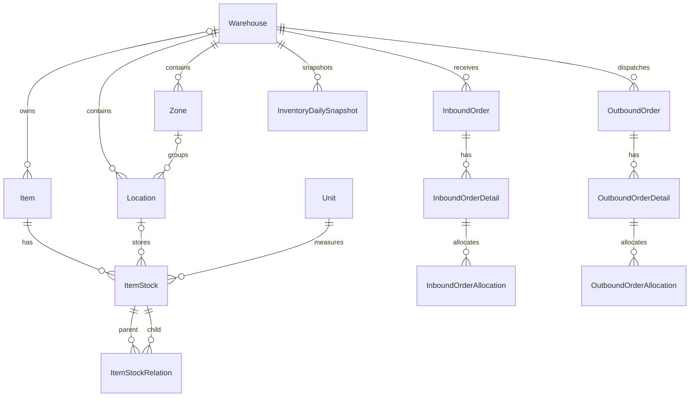

# Mô hình dữ liệu phục vụ khảo sát và báo cáo

Ngày đối chiếu: **2026-10-14**. Sơ đồ là tập con đã đọc từ model, không phải ERD toàn bộ database thực tế.

## Các khái niệm chính

| Khái niệm | Nội dung đã thấy | Nguồn |
|---|---|---|
| Kho/khu vực | `Warehouse`, `Zone`; khu vực có code, thuộc kho | [warehouse_model.py](../backend/app/modules/warehouse/warehouse_zone/warehouse_model.py) |
| Vị trí | `Location`: warehouse, zone có thể null, bin code, row/column/level, active; trạng thái tính từ đơn và tồn | [location_model.py](../backend/app/modules/warehouse/location_map/location_model.py) |
| Mã hàng/SKU | `Item`: sku, đơn vị cơ sở, base quantity, min/max quantity, details JSON | [item_model.py](../backend/app/modules/warehouse/item/item_model.py) |
| Bản ghi tồn | `ItemStock`: hàng, vị trí có thể null, đơn vị, số lượng `Numeric(12,3)`, lô, trạng thái, stock level, thời gian | [item_stock_model.py](../backend/app/modules/warehouse/item_stock/item_stock_model.py) |
| Quan hệ tồn | `ItemStockRelation`: parent/child và loại quan hệ; không mặc định các cấp được cộng cùng nhau | [item_stock_model.py](../backend/app/modules/warehouse/item_stock/item_stock_model.py) |
| Đơn và phân bổ nhập | Đơn, chi tiết, allocation; top nhập lấy số lượng từ allocation | [inbound model](../backend/app/modules/warehouse/inbound_order/inbound_order_model.py) |
| Đơn và phân bổ xuất | Đơn, chi tiết, allocation; top xuất hiện lấy số lượng từ detail | [outbound model](../backend/app/modules/warehouse/outbound_order/outbound_order_model.py) |
| Snapshot tồn | Một dòng/kho/ngày, quantity `Numeric(20,4)`, value `Numeric(20,2)`; unique `(warehouse_id, snapshot_date)` | [dashboard_model.py](../backend/app/modules/warehouse/dashboard/dashboard_model.py) |

## Các quy tắc cần đọc trước khi tổng hợp

- `countable_stock_level_criterion()` chỉ nhận `stock_level IS NULL OR stock_level <= 1`. Các cấp đóng gói con lớn hơn 1 không được tự cộng thêm.
- `positive_stock_quantity_criterion()` nhận `quantity > 0`; nhiều luồng còn yêu cầu `is_active`.
- `ItemStock.available_quantity` là số lượng trừ phân bổ outbound còn được tính; khác với `quantity`. Xem `countable_allocation_quantity()` trước khi dùng.
- `Item.quantity` hiện tính ở khu `zone_storage` **và** `zone_split`. Tổng tồn reporting/snapshot chỉ dùng `zone_storage`. Không mặc định hai màn hình phải có cùng tổng khi phạm vi khác nhau.
- Tuổi tồn reporting lọc trạng thái `available`/`split`, nhưng không join vị trí/khu vực. Phạm vi khác tổng tồn reporting.
- Giá trong báo cáo lấy từ `Item.details['price']`; source chưa xác nhận đây là giá chuẩn cho mọi đơn vị. Frontend định dạng VND; cần xác nhận quy tắc giá/đơn vị trước khi thay đổi công thức.
- Có `unit_id`, `base_unit_id`, `base_quantity` và [ItemUnit](../backend/app/modules/warehouse/unit/unit_model.py). Chưa xác minh đầy đủ quy đổi. Không khẳng định tổng số lượng giữa các SKU/đơn vị có cùng ý nghĩa vật lý.
- `created_at` của bản ghi không mặc nhiên là thời điểm nghiệp vụ hoàn thành. Báo cáo hiện dùng các mốc tạo khác nhau; xem [metrics](reporting/metrics.md).

## Khi thay đổi dữ liệu

Kiểm tra cả model, schema API, TypeScript types, truy vấn tổng hợp, task snapshot và migration. Việc model có một trường không chứng minh database đang triển khai đã có trường đó. Không chạy migration hay backfill trên database vận hành để khảo sát docs.
