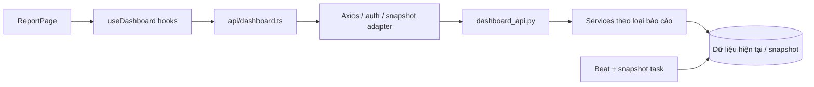

# Thống kê và biểu đồ — hiện trạng

Ngày đối chiếu source: **2026-10-19** (tuổi tồn; các cải tiến xu hướng/Top ngày 2026-10-16). Đã kiểm tra tự động kỳ xu hướng, Top, nhóm tuổi tồn và hợp đồng API bằng mock/biên dịch SQL; biểu thức ranh giới tuổi được đánh giá trên SQLite in-memory. Đã SELECT chỉ đọc SKU/tên của ba sản phẩm ngày 2026-10-16 để xác minh nhãn; chưa đối chiếu số liệu tổng hợp trên database thực tế hoặc kiểm tra giao diện trên trình duyệt.

Nhu cầu người dùng: cải thiện cách trình bày và bổ sung chỉ số/báo cáo cho cả quản lý kho và nhân viên vận hành. Xem [roadmap](roadmap.md) cho đề xuất; tài liệu này mô tả phần đã có.

## Màn hình và luồng dữ liệu

- `/report` → `ReportPage.tsx`: chỉ số và biểu đồ. Đây cũng là đích redirect mặc định `/`.
- `/dashboard` → `DashboardPage.tsx`: bản đồ kho, không phải trang biểu đồ reporting.
- Cả hai route dưới `AdminRoute` trong layout chính. Người không phải admin được chuyển sang QR tablet; mục tiêu phục vụ nhân viên vận hành chưa đồng nghĩa họ đã truy cập được `/report`.
- Kho được lấy từ `useAppStore.selectedWarehouseId`; không có kho hợp lệ thì các query reporting không chạy và UI yêu cầu chọn kho.

## Bố cục hiện tại

1. Tiêu đề “Báo cáo”, nhãn thời gian cố định **“Tháng 6 / 2026”**.
2. Bốn thẻ: tổng đơn nhập, tổng đơn xuất, giá trị tồn, cảnh báo; bấm thẻ đi tới màn hình liên quan, chưa truyền bộ lọc tương ứng.
3. “Xu hướng kho”: chọn **1 tuần / 1 tháng / 1 quý / 1 năm**, mặc định 1 tuần. Dùng kỳ lịch hiện tại đến hôm nay: tuần/tháng hiển thị theo ngày, quý/năm theo tháng. UI hiện khoảng ngày thực tế và đơn vị chia điểm; area chart số đơn nhập/xuất và biểu đồ hai đường tồn số lượng/giá trị với hai trục Y.
4. “Top N sản phẩm”: chọn **Top 5 / Top 10 / Top 15** và **1 tuần / 1 tháng / 3 tháng**, mặc định Top 5 và 1 tuần. Ba biểu đồ thanh ngang nhập nhiều, xuất nhiều, tồn nhiều cùng dùng số lượng Top đã chọn. Nhãn có hai dòng **mã SKU + tên sản phẩm**, cắt gọn khi dài; tooltip có đầy đủ mã, tên và số lượng. Chiều cao chart tăng theo số hàng và có vùng cuộn khi dài; không có dữ liệu thì hiển thị thông báo trống.
5. “Hàng tồn kho dài hạn”: danh sách 8 bản ghi tồn lâu nhất, pie chart **bốn nhóm 0–90 / 91–180 / 181–360 / trên 360 ngày** và chi tiết nhóm được chọn. Legend, tỷ trọng và nút chọn “Chi tiết nhóm” dùng cùng tập nhóm từ API; ngày 180 thuộc nhóm 91–180, không trùng nhóm sau.

Kỳ xu hướng và kỳ top độc lập; chưa có bộ lọc khoảng ngày chung hoặc điều hướng chọn kỳ quá khứ. KPI đơn nhập/xuất là tổng mọi thời điểm, không theo nhãn tháng ở tiêu đề. Top tồn là tồn hiện tại, không theo kỳ top nhập/xuất. Xem [metrics](metrics.md) trước khi sửa nhãn hoặc bổ sung filter.

## Bản đồ file và trách nhiệm

| File | Trách nhiệm |
|---|---|
| [ReportPage.tsx](../../frontend/src/pages/ReportPage.tsx) | Bố cục, chart components, tick SKU/tên và tooltip sản phẩm, lựa chọn kỳ/nhóm tuổi |
| [hooks/useDashboard.ts](../../frontend/src/hooks/useDashboard.ts) | Query keys (top gồm kỳ và limit), điều kiện gọi API, polling KPI |
| [api/dashboard.ts](../../frontend/src/api/dashboard.ts) | Năm lời gọi GET reporting |
| [types/dashboard.ts](../../frontend/src/types/dashboard.ts) | Hợp đồng TypeScript, enum kỳ/nhóm |
| [formatKpi.ts](../../frontend/src/utils/formatKpi.ts), [formatQuantity.ts](../../frontend/src/utils/formatQuantity.ts) | Định dạng VND, số lượng; parseQuantity đang cắt phần thập phân |
| [dashboard_api.py](../../backend/app/modules/warehouse/dashboard/dashboard_api.py) | Route, tham số, quyền và response model |
| [dashboard_schema.py](../../backend/app/modules/warehouse/dashboard/dashboard_schema.py) | Pydantic response; số tiền/số lượng Decimal ở nhiều trường |
| [dashboard_service.py](../../backend/app/modules/warehouse/dashboard/dashboard_service.py) | Gom KPI từ service nhập/xuất/hàng/thông báo |
| [dashboard_trend_periods.py](../../backend/app/modules/warehouse/dashboard/dashboard_trend_periods.py) | Kiểu kỳ week/month/quarter/year và ranh giới kỳ lịch, không phụ thuộc database |
| [dashboard_trend_service.py](../../backend/app/modules/warehouse/dashboard/dashboard_trend_service.py) | Đếm đơn, lấy snapshot, tổng hợp theo kỳ lịch hiện tại đến hôm nay |
| [dashboard_top_products_service.py](../../backend/app/modules/warehouse/dashboard/dashboard_top_products_service.py) | Top 5/10/15 theo tổng số lượng, kỳ 7/30/90 ngày |
| [dashboard_stock_aging_service.py](../../backend/app/modules/warehouse/dashboard/dashboard_stock_aging_service.py) | Nhóm tuổi, tỷ trọng, top 8 và chi tiết tối đa 500 dòng |
| [dashboard_snapshot_service.py](../../backend/app/modules/warehouse/dashboard/dashboard_snapshot_service.py) | Tổng tồn live, giá trị và upsert snapshot theo ngày |
| [dashboard_model.py](../../backend/app/modules/warehouse/dashboard/dashboard_model.py) | Model `InventoryDailySnapshot` |
| [dashboard_celery_task.py](../../backend/app/modules/warehouse/dashboard/dashboard_celery_task.py) | Task `dashboard.snapshot_inventory_daily` |
| [core/celery_app.py](../../backend/app/core/celery_app.py) | Lịch Beat và route task vào queue `logic` |

## Hợp đồng API hiện tại

Prefix đầy đủ: `/api/v1/dashboard`. Tất cả endpoint yêu cầu `warehouse_id` số nguyên >0.

| GET endpoint | Tham số thêm | Response chính | Quyền |
|---|---|---|---|
| `/report-kpis` | Không | `ReportKpiResponse` | `inbound:read`, `outbound:read`, `item:read`, `notification:read` |
| `/report-trends` | `granularity=week\|month\|quarter\|year`, mặc định week | `ReportTrendResponse` | `inbound:read`, `outbound:read`, `item:read` |
| `/report-top-products` | `period=week\|month\|three_months`, mặc định week; `limit=5\|10\|15`, mặc định 5 | `ReportTopProductsResponse` (có `period`, `limit` và ba danh sách) | Như trends |
| `/report-stock-aging` | Không | `ReportStockAgingOverviewResponse` | `item:read` |
| `/report-stock-aging/bucket` | `bucket=lte_90\|days_91_180\|days_181_360\|gt_360`, bắt buộc | `ReportStockAgingBucketResponse` | `item:read` |

`require_permission()` yêu cầu **tất cả** quyền được liệt kê; admin hoặc quyền `*` được bypass theo [dependencies](../../backend/app/core/dependencies.py). Router reporting không thể hiện kiểm tra user-kho riêng; cần kiểm tra phạm vi truy cập khi mở báo cáo cho vai trò mới, không mặc định UI chọn kho là kiểm soát quyền API.

Từ 2026-10-16, `granularity=day` cũ không còn hợp lệ (HTTP 422); `week` đổi nghĩa từ 12 tuần sang một tuần hiện tại. Frontend/backend cần được cập nhật cùng nhau. Hooks và API client hiện truyền kiểu `TrendGranularity`, không cần đổi tên tham số hoặc query key.

Từ 2026-10-19, ba bucket tuổi tồn cũ `lte_30/days_31_60/gt_60` được thay bằng bốn bucket mới trong bảng. Mã cũ trả HTTP 422; frontend/backend phải cập nhật cùng nhau. Không thay đổi cách tính holding_days, nguồn tồn hoặc ngưỡng cảnh báo của phân hệ thông báo.

## Query và cập nhật

| Query key | Cập nhật |
|---|---|
| `['dashboard', 'report-kpis', warehouseId]` | Poll 30 giây, cả khi tab nền |
| `['dashboard', 'report-trends', warehouseId, granularity]` | Không khai báo polling riêng |
| `['dashboard', 'top-products', warehouseId, period, limit]` | Đổi kỳ/Top gọi đúng query mới; không khai báo polling riêng |
| `['dashboard', 'stock-aging', warehouseId]` | Không khai báo polling riêng |
| `['dashboard', 'stock-aging-bucket', warehouseId, bucket]` | Chỉ chạy khi đã chọn nhóm, không polling riêng |

Tất cả dùng `LIVE_QUERY_OPTIONS`: `staleTime=0`, `gcTime=0`, `refetchOnMount='always'`. Các cơ chế refetch mặc định của thư viện vẫn có thể áp dụng; không mô tả toàn trang là realtime 30 giây. Đổi kho reset nhóm tuổi rồi chọn nhóm có tổng số lượng lớn nhất khi nhận dữ liệu mới.

## Các giới hạn cần nhớ

- Nhãn thời gian cố định không phản ánh phạm vi dữ liệu thực tế.
- Tồn biểu đồ chỉ từ snapshot Celery **23:00** (VN); ngày thiếu snapshot = 0. Tuần/tháng theo ngày; quý/năm theo tồn cuối tháng.
- API báo cáo không ghi snapshot; mỗi kho một dòng/ngày sau khi task chạy.
- Phạm vi lọc tuổi tồn khác tổng tồn. Không dùng tỷ trọng tuổi tồn để giải thích tổng tồn storage mà chưa đối chiếu.
- Số lượng/money Decimal có thể qua API dưới dạng chuỗi; frontend đang cắt thập phân trong một số đường parse/format. Không đổi quy tắc làm tròn trong nhiệm vụ thuần giao diện mà không ghi nhận.
- UI có loading và trường hợp trống; chưa có phần lỗi và nút retry riêng cho từng nhóm query trong `ReportPage`.
- Bucket detail tối đa 500 dòng, chưa có metadata phân trang/tổng dòng trong response.
- Hiệu năng truy vấn và dữ liệu lớn chưa đo. Tiến trình Beat, độ đầy đủ snapshot và quyền thực tế chưa xác minh runtime.

Kiểm chứng: [validation](validation.md). Định nghĩa chi tiết và điểm tái sử dụng: [metrics](metrics.md).
