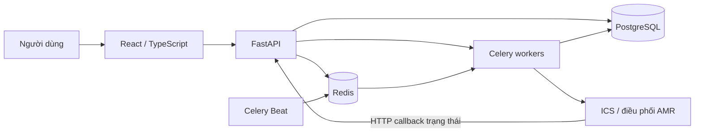

# Tổng quan hệ thống

Ngày đối chiếu source: **2026-10-14**. Phạm vi: cấu trúc và điểm tích hợp; chưa xác minh runtime.

## Bối cảnh được người dùng xác nhận

- Quản lý hàng hóa trong kho sản xuất các chi tiết nhựa nhỏ.
- Hàng hóa được luân chuyển bằng AMR.
- Nghiệp vụ: inbound, outbound, kiểm kê, thống kê và quản lý kho.
- Nhập/xuất hiện đang ổn định; ưu tiên trước mắt là docs, sau đó cải thiện biểu đồ và bổ sung báo cáo.
- Báo cáo cần phục vụ cả quản lý kho và nhân viên vận hành. Đây là đối tượng mong muốn, không phải xác nhận mọi đối tượng đã được cấp quyền vào trang báo cáo.
- Đơn vị vận chuyển vật lý của AMR và quy đổi đơn vị hàng hóa còn cần xác nhận; không mặc định một bản ghi tồn tương ứng một chi tiết/thùng/khay.

## Thành phần đã thấy trong source

Sơ đồ mô tả liên kết theo source, không khẳng định tất cả tiến trình đang chạy. Beat có cấu hình trong code nhưng chưa thấy service Beat riêng trong compose gốc.

| Thành phần | Trách nhiệm | Nguồn |
|---|---|---|
| Frontend | Màn hình, chọn kho, gọi API, cache truy vấn, biểu đồ Recharts | [package](../frontend/package.json), [routes](../frontend/src/routes/index.tsx) |
| Backend API | Đăng ký router dưới `/api/v1`, xác thực/phân quyền, gọi xử lý nghiệp vụ | [main](../backend/app/main.py), [dependencies](../backend/app/core/dependencies.py) |
| Database | Lưu master data, tồn, đơn, lịch sử, nhiệm vụ robot, snapshot | [database](../backend/app/core/database.py), [metadata migration](../backend/alembic/env.py) |
| Redis | Cache/pubsub và broker/result backend Celery theo cấu hình | [cache](../backend/app/core/cache.py), [Celery](../backend/app/core/celery_app.py) |
| Celery | Queue `logic`, `status`; xử lý công việc nền và lưu trạng thái | [Celery config](../backend/app/core/celery_app.py) |
| ICS/AMR | Gửi lệnh và tiếp nhận trạng thái robot; chưa khảo sát toàn bộ giao thức | [robot service](../backend/app/modules/robot/robot_service.py), [callback API](../backend/app/modules/robot/robot_api.py) |

## Các luồng cần phân biệt

- **Đọc báo cáo:** giao diện → query hook → API → service tổng hợp → database.
- **Lịch sử tồn:** Beat → task snapshot → tổng hợp tồn hiện tại → `inventory_daily_snapshot` → API xu hướng.
- **Vận hành kho/AMR:** đơn và phân bổ → tác vụ robot → ICS → callback → cập nhật nghiệp vụ. Mới lập bản đồ, chưa xác minh đầy đủ chuyển trạng thái.
- **Demo offline:** Axios có snapshot adapter khi `VITE_SNAPSHOT_MODE=true`; dữ liệu demo không chứng minh API thật hoặc cơ chế phân quyền thật đang hoạt động.

## Ranh giới ưu tiên

Reporting được khảo sát chi tiết. Các phân hệ còn lại có bản đồ đầu mối để đọc sâu khi có nhiệm vụ. Việc làm báo cáo có thể cần đọc model/service nhập xuất, nhưng không kéo theo sửa luồng vận hành.

Chi tiết: [danh mục chức năng](feature-catalog.md), [mô hình dữ liệu](data-model.md), [reporting](reporting/overview.md).
